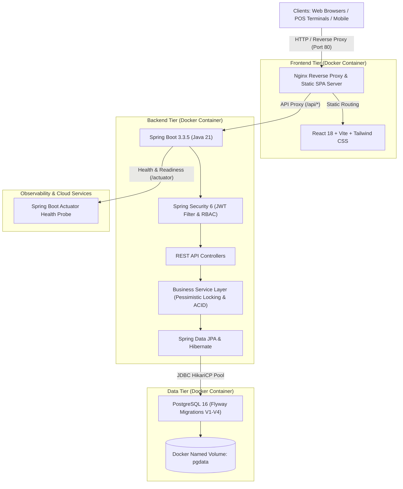
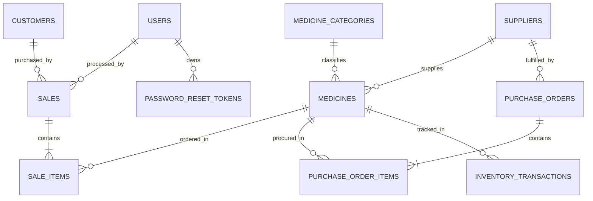
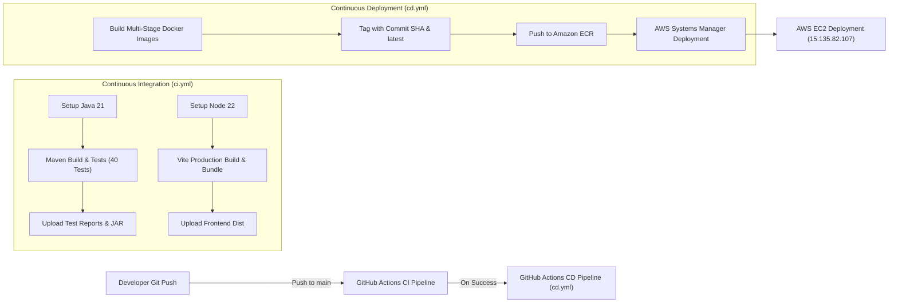

# MediCore – Smart Pharmacy Management Platform

### Cloud Deployment, Docker Containerization, CI/CD Automation & Full-Stack SaaS Architecture


---

## 1. Project Overview
**MediCore** is an enterprise-grade, commercial healthcare SaaS platform engineered for clinical pharmacies, hospital dispensaries, and retail medical chains. Built using modern cloud-native architectural patterns, MediCore streamlines Point of Sale (POS) billing, lot-level inventory tracking, vendor procurement reconciliation, automated expiration detection, and executive analytics.

Unlike standard tutorial applications, MediCore operates exclusively with normalized PostgreSQL database records, ACID-compliant transactional guarantees, pessimistic row locking to prevent overselling, and automated continuous delivery directly to Amazon Web Services (AWS).

---

## 2. Business Problem
Traditional pharmacy and dispensary management suffers from severe operational bottlenecks:
1. **Manual Inefficiencies:** Handwritten billing, paper records, and uncoordinated vendor communication cause order errors and inventory discrepancies.
2. **Clinical Expiry Risks:** Dispensing expired drugs carries critical health hazards and regulatory penalties. Without automated pre-expiry detection (30-day alerts), pharmacies endure heavy financial shrinkage.
3. **Inventory Stockouts:** High-demand life-saving medicines frequently run out without automated minimum-threshold notifications.
4. **DevOps & Cloud Gaps:** Traditional deployments suffer from downtime, environment drift, lack of automated testing, and unverified manual server changes.

---

## 3. Architecture

MediCore implements a decoupled, 3-tier containerized architecture orchestrated via Docker Compose and deployed on AWS EC2:



### Architectural Highlights
- **Stateless Application Tier:** Spring Boot runs in a stateless session configuration; all authentication context is derived from cryptographically signed HMAC-SHA256 JWT tokens.
- **Pessimistic Locking on Checkout:** `SaleService` acquires `@Lock(LockModeType.PESSIMISTIC_WRITE)` on medicine rows during checkout, issuing `SELECT ... FOR UPDATE` in PostgreSQL to eliminate concurrency race conditions.
- **Persistent Storage:** PostgreSQL state is mounted to a managed Docker volume (`pgdata`), ensuring data survives container restarts and upgrades.

---

## 4. Technology Stack

| Layer | Technologies |
|---|---|
| **Frontend** | React 18, Vite 5, JavaScript, Tailwind CSS 3, Lucide React, Recharts, Axios, React Router 6 |
| **Backend** | Java 21, Spring Boot 3.3.5, Spring Security 6, Spring Data JPA, Hibernate, Maven, JJWT 0.12.6 |
| **Database** | PostgreSQL 16 Alpine, Flyway Database Migrations (V1, V2, V3, V4) |
| **Containerization** | Docker Engine, Docker Compose, Multi-stage builds, Alpine Linux |
| **DevOps & CI/CD** | Git, GitHub, GitHub Actions, Docker Buildx, Shell Scripting |
| **AWS Cloud** | Amazon EC2 (`t3.micro`), Amazon ECR, AWS IAM, AWS Systems Manager (SSM) |
| **Web Server** | Nginx 1.27 Alpine (Reverse Proxy & Static Web Server) |

---

## 5. Repository Structure

```text
pharmacy-management-platform/
├── .github/
│   └── workflows/
│       ├── ci.yml                 # Automated Continuous Integration (Java 21 + Node 22)
│       └── cd.yml                 # Automated Continuous Deployment (ECR + EC2 via SSM)
├── backend/
│   ├── src/
│   │   ├── main/
│   │   │   ├── java/com/medicore/ # Controllers, Services, Entities, DTOs, Security
│   │   │   └── resources/
│   │   │       ├── application.yml
│   │   │       └── db/migration/  # Flyway SQL migrations (V1 to V4)
│   │   └── test/                  # 40 automated unit & integration tests
│   ├── Dockerfile                 # Multi-stage Java 21 JRE Alpine Dockerfile
│   └── pom.xml                    # Maven dependency management
├── frontend/
│   ├── src/                       # React components, pages, context, and API clients
│   ├── nginx.conf                 # Nginx reverse proxy configuration
│   ├── Dockerfile                 # Multi-stage Node 22 + Nginx Alpine Dockerfile
│   └── package.json               # NPM dependencies and build scripts
├── docs/                          # Comprehensive architectural specifications & guides
├── scripts/
│   ├── backup.sh                  # Encrypted database backup utility
│   ├── restore.sh                 # Database restore utility
│   ├── rollback.sh                # Release rollback procedure
│   └── health-check.sh            # Automated service health evaluation
├── docker-compose.yml             # Development / Staging orchestration stack
├── docker-compose.prod.yml        # Production orchestration stack
├── .env.example                   # Environment configuration template
├── OPERATIONS.md                  # Operational runbook
├── SUBMISSION_CHECKLIST.md        # Internship submission verification checklist
├── DEMO_SCRIPT.md                 # 3–5 minute presentation script
└── README.md                      # Master documentation
```

---

## 6. Prerequisites

Ensure the following tools are installed on your host machine:
- **Docker Engine** (version 24.0+) & **Docker Compose** (v2.20+)
- **Java Development Kit (JDK)**: Version 21 LTS (for local backend development)
- **Apache Maven**: Version 3.9+ (for backend compilation and test execution)
- **Node.js**: Version 20 LTS or 22 LTS (for local frontend development)
- **Git**: Version 2.40+

---

## 7. Local Setup (Standalone Development)

### A. Clone the Repository
```bash
git clone https://github.com/sunilganganagunta/pharmacy-management-platform.git
cd pharmacy-management-platform
```

### B. Backend Local Execution
```bash
# Start standalone PostgreSQL container
docker run -d --name local-postgres -p 5432:5432 -e POSTGRES_DB=medicoredb -e POSTGRES_USER=medicore_user -e POSTGRES_PASSWORD=medicore_pass123 postgres:16-alpine

# Run Spring Boot backend
cd backend
mvn spring-boot:run
```
The backend initializes database tables via Flyway and listens at `http://localhost:8080`.

### C. Frontend Local Execution
```bash
cd frontend
npm install
npm run dev
```
The Vite development server starts at `http://localhost:5173`.

---

## 8. Docker Compose Setup

Run the full production-grade multi-container stack with a single command:

```bash
# 1. Create environment file from template
cp .env.example .env

# 2. Build and start all 3 services in detached mode
docker compose up -d --build

# 3. Verify running containers and health checks
docker compose ps
```

### Container Stack Ports
- **Frontend & Reverse Proxy:** `http://localhost:80`
- **Backend Actuator & REST API:** `http://localhost:8080`
- **PostgreSQL Database:** `localhost:5432`

---

## 9. Environment Variable Reference

Configurable parameters in `.env` (derived from `.env.example`):

| Variable | Default Value | Description |
| :--- | :--- | :--- |
| `POSTGRES_DB` | `medicoredb` | Primary database name |
| `POSTGRES_USER` | `medicore_user` | Database user account |
| `POSTGRES_PASSWORD` | `medicore_pass123` | Database user password |
| `POSTGRES_PORT` | `5432` | Exposed PostgreSQL port |
| `SPRING_PROFILES_ACTIVE` | `prod` | Spring Boot active profile |
| `SERVER_PORT` | `8080` | Backend application port |
| `JWT_SECRET` | `(64-char hex key)` | 256-bit secret for signing HMAC-SHA256 JWT tokens |
| `JWT_EXPIRATION_MS` | `86400000` | JWT token validity in milliseconds (24 hours) |
| `CORS_ALLOWED_ORIGINS` | `http://localhost...` | Comma-delimited list of allowed CORS origins |
| `FRONTEND_PORT` | `80` | Public Nginx web server port |

---

## 10. API Endpoints

All business endpoints require a valid JWT Bearer token: `Authorization: Bearer <token>`.

### Authentication (`/api/auth`)
| Method | Endpoint | Description | Access |
| :--- | :--- | :--- | :--- |
| `POST` | `/api/auth/login` | Authenticate user & issue JWT token | Public |
| `POST` | `/api/auth/register` | Self-registration (strictly forces `PHARMACIST` role) | Public |
| `POST` | `/api/auth/forgot-password` | Initiate password reset (15-min token, anti-enumeration) | Public |
| `POST` | `/api/auth/reset-password` | Confirm password reset with single-use token | Public |
| `GET` | `/api/auth/me` | Retrieve currently authenticated user profile | Authenticated |

### Medicines & Catalog (`/api/medicines`)
| Method | Endpoint | Description | Access |
| :--- | :--- | :--- | :--- |
| `GET` | `/api/medicines` | Paginated, searchable medicine catalogue | Authenticated |
| `GET` | `/api/medicines/{id}` | Retrieve single medicine by ID | Authenticated |
| `POST` | `/api/medicines` | Create new medicine with batch & expiry | `ADMIN`, `PHARMACIST` |
| `PUT` | `/api/medicines/{id}` | Update existing medicine details | `ADMIN`, `PHARMACIST` |
| `DELETE` | `/api/medicines/{id}` | Deactivate (soft-delete) medicine | `ADMIN` only |

### Point of Sale & Billing (`/api/sales`)
| Method | Endpoint | Description | Access |
| :--- | :--- | :--- | :--- |
| `POST` | `/api/sales` | 2-Phase atomic sale checkout, stock decrement & tax invoice | Authenticated |
| `GET` | `/api/sales` | Paginated sales transaction history | Authenticated |
| `GET` | `/api/sales/{id}/invoice` | Generate printable tax invoice | Authenticated |

### Inventory & Procurement
| Method | Endpoint | Description | Access |
| :--- | :--- | :--- | :--- |
| `GET` | `/api/inventory/history` | Auditable stock transaction ledger | Authenticated |
| `POST` | `/api/inventory/adjust` | Manual inventory adjustment (`ADJUSTMENT`, `DAMAGE`) | `ADMIN`, `PHARMACIST` |
| `GET` | `/api/purchases` | Paginated purchase orders | Authenticated |
| `POST` | `/api/purchases` | Create vendor purchase order | `ADMIN` |
| `PATCH` | `/api/purchases/{id}/status` | Mark PO as `RECEIVED` (increments stock) | Authenticated |

### Reports & Analytics (`/api/reports`)
| Method | Endpoint | Description | Access |
| :--- | :--- | :--- | :--- |
| `GET` | `/api/reports/sales` | Sales revenue reports with time range filter | Authenticated |
| `GET` | `/api/reports/inventory` | Inventory status report (all, low stock, expired) | Authenticated |
| `GET` | `/api/reports/export/sales` | Stream sales transaction CSV export | Authenticated |
| `GET` | `/api/reports/export/inventory` | Stream inventory valuation CSV export | Authenticated |

---

## 11. Database and Migrations

MediCore manages relational schema evolution using **Flyway Database Migrations**:



### Migration History
- **`V1__init_schema.sql`:** Creates tables (`users`, `medicines`, `suppliers`, `customers`, `sales`, `sale_items`, `purchase_orders`, `inventory_transactions`) with foreign keys and check constraints (`available_quantity >= 0`).
- **`V2__seed_initial_data.sql`:** Seeds default medicine categories, suppliers, and clinical medicines.
- **`V3__add_cashier_and_password_reset_tokens.sql`:** Adds `password_reset_tokens` table for SEC-02 and documents 3-tier RBAC.
- **`V4__fix_pharmacist_password_hash.sql`:** Synchronizes the default pharmacist seed password hash to the true BCrypt hash for `Pharmacist@123`.

---

## 12. CI/CD Workflow



---

## 13. AWS Deployment Architecture

MediCore is deployed on AWS in the **Sydney Region (`ap-southeast-2`)**:

| AWS Service | Resource Identifier / Config | Role in Architecture |
| :--- | :--- | :--- |
| **Amazon EC2** | `i-0be536c99a4381e25` (`t3.micro`) | Hosts Docker Compose stack (Nginx, Backend, PostgreSQL) |
| **Public Elastic IP** | `15.135.82.107` | Public ingress routing |
| **Security Group** | `medicore-app-sg` | Allows ingress HTTP (80) & HTTPS (443); SSH (22) closed to public |
| **Amazon ECR** | `medicore-backend`, `medicore-frontend` | Private container image registry |
| **AWS IAM** | `medicore-ec2-role` | Grants EC2 permissions to pull from ECR and execute SSM commands |
| **AWS Systems Manager** | AWS SSM Agent on EC2 | Enables secure, agent-based remote command execution without open SSH |

---

## 14. Health Checks

### Spring Boot Actuator Health Probe
- **Endpoint:** `GET /actuator/health`
- **Verification Command:** `curl -i http://localhost:8080/actuator/health`
- **Output:** `{"status":"UP"}` (Validates PostgreSQL connection pool, disk space, and liveness).

### PostgreSQL Container Readiness Check
- **Verification Command:** `docker compose exec postgres pg_isready -U medicore_user -d medicoredb`
- **Output:** `/var/run/postgresql:5432 - accepting connections`

### Nginx Reverse Proxy Probe
- **Verification Command:** `curl -I http://localhost:80/`
- **Output:** `HTTP/1.1 200 OK` (`Server: nginx/1.27.5`)

---

## 15. Logging and Troubleshooting

### Viewing Logs
```bash
# View backend Spring Boot logs in real-time
docker compose logs -f backend

# View Nginx access and error logs
docker compose logs -f frontend

# View PostgreSQL database transaction logs
docker compose logs -f postgres
```

### Common Issues & Remediation
- **Database Connection Refused:** Ensure `postgres` service reports healthy before starting backend (`depends_on.postgres.condition: service_healthy`).
- **Nginx 502 Bad Gateway:** Backend container is starting up or restarting; monitor `docker compose logs -f backend`.
- **Port 80 Already Bound:** Check host web servers (`sudo systemctl stop nginx`).

---

## 16. Backup and Restore Instructions

### Automated Encrypted Backup
```bash
# Trigger database backup
bash ./scripts/backup.sh
```
Executes `pg_dump`, gzip compresses the archive, checks file integrity (> 1024 bytes), encrypts using OpenSSL AES-256-CBC, and stores output in `/var/backups/medicore/`.

### Database Restore Procedure
```bash
# Restore from backup archive
bash ./scripts/restore.sh /var/backups/medicore/medicoredb_20261112.sql.gz.enc medicoredb
```

---

## 17. Rollback Procedure

In the event of an unhealthy release:
```bash
# Revert to previous verified version
bash ./scripts/rollback.sh
```
The script reads `previous_version.txt`, updates `.env` image tags, redeploys containers via `docker compose`, and verifies service availability via `health-check.sh`.

---

## 18. Security Considerations

1. **Principle of Least Privilege (SEC-01 & SEC-03):** Public self-registration (`/api/auth/register`) strictly forces the `PHARMACIST` role. Administrative privilege assignment is restricted to authenticated administrators.
2. **Cryptographic Password Reset (SEC-02):** Reset tokens are generated with 32 bytes of secure random entropy, stored as SHA-256 hashes, expire in 15 minutes, are single-use, and rate-limited to 5 requests per 15 minutes per email.
3. **Pessimistic Concurrency Locking:** `SaleService` locks medicine inventory rows with `@Lock(LockModeType.PESSIMISTIC_WRITE)` to eliminate race conditions and overselling.
4. **Non-Root Container Execution:** Backend Docker container runs under an unprivileged user `medicore`.
5. **No Committed Secrets:** Repository ignores `.env`, private keys, and credential stores.

---

## 19. Testing Instructions

### Backend Test Suite (Maven)
```bash
cd backend
mvn test
```
Executes 40 unit and integration tests covering authentication, role boundaries, sale validation, inventory adjustments, and token lifecycles with a **100% pass rate**.

### Frontend Production Build (Vite)
```bash
cd frontend
npm run build
```
Compiles and bundles production static assets with zero errors into `frontend/dist/`.

---

## 20. Known Limitations

1. **HTTPS / TLS Domain Binding:** The live instance serves HTTP on port 80 (`http://15.135.82.107/`). Automated Let's Encrypt SSL requires a registered custom domain A-record pointed to the IP address.
2. **AWS Organization SCP Gate:** Direct automated CD push to ECR from GitHub Actions requires administrative Service Control Policy authorization within the AWS Organization.
3. **Email Delivery Provider:** Password reset tokens and low stock alerts are logged to secure operational audit logs; integration with Amazon SES or SMTP can be enabled by setting standard mail environment variables.

---

**Developed for ALGiONS AI LABS PRIVATE LIMITED Internship Assignment.**  
*DevOps and Cloud Engineering Intern*
