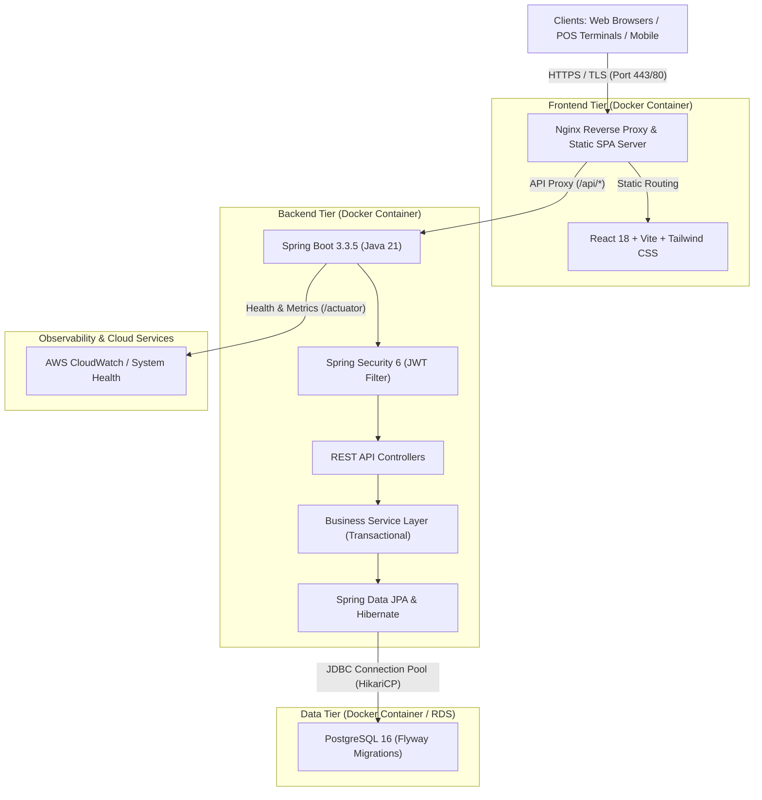
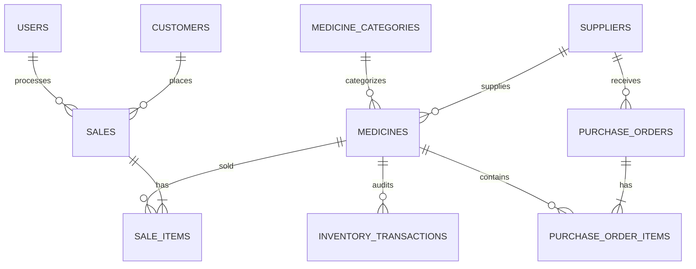
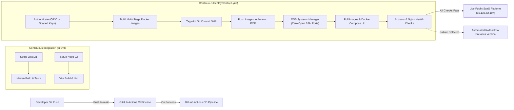

# MediCore – Smart Pharmacy Management Platform
### Cloud Deployment, Docker Containerization, CI/CD Automation & Full-Stack SaaS Architecture

[](https://github.com/sunilganganagunta/pharmacy-management-platform/actions/workflows/ci.yml)
[](https://github.com/sunilganganagunta/pharmacy-management-platform/actions/workflows/cd.yml)
[](https://www.oracle.com/java/)
[](https://spring.io/projects/spring-boot)
[](https://react.dev/)
[](https://www.docker.com/)
[](https://aws.amazon.com/)
[]()

> A full-stack pharmacy management platform with Java Spring Boot, React, PostgreSQL, Docker, GitHub Actions CI/CD and AWS deployment.

> **Tagline:** Smart Pharmacy Management. Simplified.  
> **Company:** ALGiONS AI LABS PRIVATE LIMITED  
> **Designation:** DevOps and Cloud Engineering Intern  
> **Project:** Cloud Deployment & CI/CD – Pharmacy Management Platform  

---

## 1. Project Overview
**MediCore** is an enterprise-grade, commercial healthcare SaaS platform engineered for clinical pharmacies, hospital dispensaries, and retail medical chains. Built using modern cloud-native architectural patterns, MediCore streamlines Point of Sale (POS) billing, lot-level inventory tracking, vendor procurement reconciliation, automated expiration detection, and executive analytics.

Unlike standard tutorial applications, MediCore operates exclusively with normalized PostgreSQL database records, ACID-compliant transactional guarantees, and automated continuous delivery directly to Amazon Web Services (AWS).

---

## 2. Problem Statement
Traditional pharmacy and dispensary management suffers from severe operational bottlenecks:
1. **Manual Inefficiencies:** Handwritten billing, paper records, and uncoordinated vendor communication cause order errors and inventory discrepancies.
2. **Clinical Expiry Risks:** Dispensing expired drugs carries critical health hazards and regulatory penalties. Without automated pre-expiry detection (30-day alerts), pharmacies endure heavy financial shrinkage.
3. **Inventory Stockouts:** High-demand life-saving medicines frequently run out without automated minimum-threshold notifications.
4. **DevOps & Cloud Gaps:** Traditional deployments suffer from downtime, environment drift, lack of automated testing, and unverified manual server changes.

---

## 3. Project Objectives
- Build an enterprise-ready, multi-tier pharmacy SaaS platform adhering to modern UI/UX design standards.
- Enforce strict database transactions preventing negative stock and blocking sales of expired medicines.
- Implement multi-stage Docker containerization for minimal, secure, and non-root execution.
- Create an automated **CI/CD pipeline** via GitHub Actions: **Code Push &rarr; Automated Build & Test &rarr; Publish to Amazon ECR &rarr; Automated Zero-Downtime Deployment to AWS EC2**.
- Architect secure AWS cloud infrastructure adhering to the principle of least privilege.

---

## 4. Main Features
- **Executive Operations Dashboard:** Real-time KPI cards (Total Medicines, Valuation, Today's Sales, Monthly Revenue, Expiring Lots), interactive weekly/monthly Recharts, and live alert streams.
- **Point of Sale (POS) Terminal:** Search-as-you-type drug catalog, barcode scan lookup, shopping cart, custom discounts, 12% GST calculation, Cash/Card/UPI support, and printable tax invoices.
- **Medicine Catalog CRUD:** Manage brand names, generic formulas, batches, barcodes, manufacturing and expiry dates, selling and purchase prices, and minimum stock alerts.
- **Inventory Ledger & Auditing:** Granular transaction history logging every `STOCK_IN`, `STOCK_OUT`, `ADJUSTMENT`, `SALE`, and `PURCHASE_RECEIVE`.
- **Purchase Order (PO) Management:** Vendor procurement creation with multi-item line rows. Automatic inventory lot increment occurs only when an order is received.
- **Vendor Directory:** Track pharmaceutical suppliers, corporate details, contact persons, and purchase history.
- **Customer Profiles:** Enrolled patients, loyalty purchase tracking, and contact directories.
- **Executive Reports & CSV Export:** Filter sales by daily, weekly, monthly, or annual horizons; itemized inventory valuation; and one-click CSV file downloads.
- **Alert Center:** Proactive notifications for low stock, lots expiring within 30 days, expired medicine quarantine, and purchase updates.
- **Role-Based Access Control:** Separate permissions for `ADMIN` and `PHARMACIST` accounts.

---

## 5. Technology Stack

| Layer | Technologies |
|---|---|
| **Frontend** | React 18, Vite, JavaScript, Tailwind CSS, Lucide React, Recharts, Axios, React Router 6 |
| **Backend** | Java 21, Spring Boot 3.3.5, Spring Security 6, Spring Data JPA, Hibernate, Maven, JWT (JJWT 0.12.6) |
| **Database** | PostgreSQL 16, Flyway Database Migrations |
| **Containerization** | Docker Engine, Docker Compose, Multi-stage builds, Alpine Linux |
| **DevOps & CI/CD** | Git, GitHub, GitHub Actions, Docker Buildx, Shell Scripting |
| **AWS Cloud** | Amazon EC2 (Ubuntu), Amazon ECR, AWS IAM, Security Groups, CloudWatch |
| **Web Server** | Nginx (Reverse Proxy & Static Web Server), Let's Encrypt SSL/TLS |

---

## 6. System Architecture



For complete architectural specifications, see [ARCHITECTURE.md](file:///c:/Users/sunil/OneDrive/Desktop/Pharmacy%20Management%20Platform/docs/ARCHITECTURE.md).

---

## 7. Database ER Diagram



For full table schemas, foreign keys, and index configurations, see [ER_DIAGRAM.md](file:///c:/Users/sunil/OneDrive/Desktop/Pharmacy%20Management%20Platform/docs/ER_DIAGRAM.md).

---

## 8. Project Folder Structure
```
pharmacy-management-platform/
├── .github/
│   └── workflows/
│       ├── ci.yml                 # Automated Continuous Integration (Build & Test)
│       └── cd.yml                 # Automated Continuous Deployment to AWS ECR & EC2
├── backend/
│   ├── src/
│   │   ├── main/
│   │   │   ├── java/com/medicore/ # Controllers, Services, Repositories, DTOs, Security
│   │   │   └── resources/
│   │   │       ├── application.yml
│   │   │       └── db/migration/  # Flyway schema V1 & dynamic seed data V2
│   │   └── test/                  # Automated unit and integration test suite
│   ├── Dockerfile                 # Multi-stage Java 21 build
│   └── pom.xml                    # Maven dependencies
├── frontend/
│   ├── src/
│   │   ├── api/                   # Axios client with JWT interceptor
│   │   ├── components/            # Navbar, Sidebar, Layout, StatCard, Modals, Badges
│   │   ├── context/               # AuthContext, ThemeContext, NotificationContext
│   │   └── pages/                 # Dashboard, POS, Medicines, Inventory, Purchases, etc.
│   ├── Dockerfile                 # Multi-stage Node 22 -> Nginx Alpine build
│   ├── nginx.conf                 # Production reverse proxy and security headers
│   └── package.json
├── docs/
│   ├── ARCHITECTURE.md            # System Architecture & Sequence Workflows
│   ├── AWS_DEPLOYMENT_GUIDE.md    # End-to-end AWS EC2, ECR, IAM, Security Groups
│   ├── ER_DIAGRAM.md              # Database Schema & Relational Specifications
│   ├── INTERVIEW_PREP.md          # Comprehensive Interview Q&A & Demonstration Script
│   └── PRESENTATION_SLIDES.md     # 10-Slide Internship Review Deck
├── scripts/
│   ├── deploy.sh                  # Host deployment execution
│   ├── rollback.sh                # Automated rollback procedure
│   └── health-check.sh            # Production health verification
├── docker-compose.yml             # Local development multi-container orchestration
├── docker-compose.prod.yml        # Production AWS EC2 orchestration with ECR images
└── README.md
```

---

## 9. Local Installation & Prerequisites

Ensure the following tools are installed on your machine:
- **Java Development Kit (JDK):** Version 21 LTS
- **Node.js:** Version 20+ and npm
- **Apache Maven:** Version 3.9+
- **Docker & Docker Compose:** Latest version
- **Git**

### Clone the Repository
```bash
git clone https://github.com/your-username/pharmacy-management-platform.git
cd pharmacy-management-platform
```

---

## 10. Environment Configuration

Copy the example environment settings or create a `.env` file in the root directory:

```env
# PostgreSQL Database Settings
POSTGRES_DB=medicoredb
POSTGRES_USER=medicore_user
POSTGRES_PASSWORD=medicore_pass123

# Spring Boot & Security Settings
JWT_SECRET=404E635266556A586E3272357538782F413F4428472B4B6250645367566B5970
JWT_EXPIRATION_MS=86400000
CORS_ALLOWED_ORIGINS=http://localhost,http://localhost:80,http://localhost:5173

# Production Deployment Settings
ECR_REGISTRY=123456789012.dkr.ecr.ap-south-1.amazonaws.com
IMAGE_TAG=latest
```

---

## 11. Application Execution

### Option A: Complete Docker Compose Execution (Recommended)
Launch the entire stack (PostgreSQL, Spring Boot Backend, and React Nginx Frontend) with a single command:

```bash
docker compose up -d --build
```

- **Frontend Application:** Open [http://localhost](http://localhost) in your browser.
- **Backend API & Actuator:** [http://localhost:8080/actuator/health](http://localhost:8080/actuator/health)
- **OpenAPI / Swagger Documentation:** [http://localhost:8080/swagger-ui.html](http://localhost:8080/swagger-ui.html)

### Option B: Local Standalone Development

#### 1. Start PostgreSQL
```bash
docker run -d --name local-postgres -p 5432:5432 \
  -e POSTGRES_DB=medicoredb \
  -e POSTGRES_USER=medicore_user \
  -e POSTGRES_PASSWORD=medicore_pass123 \
  postgres:16-alpine
```

#### 2. Start Backend (Spring Boot 3)
```bash
cd backend
mvn spring-boot:run
```

#### 3. Start Frontend (Vite)
```bash
cd frontend
npm install
npm run dev
```
Open [http://localhost:5173](http://localhost:5173).

---

## 12. Default Demo Credentials

The platform is pre-loaded with demonstration accounts for evaluation:

| Role | Username / Email | Password | Access Scope |
|------|------------------|----------|--------------|
| **Admin** | `admin@medicore.com` | `Admin@123` | Full access: Users, Catalog, POS, Procurement, Reports, Analytics |
| **Pharmacist** | `pharmacist@medicore.com` | `Pharmacist@123` | Operations access: Catalog, POS Billing, Stock Adjustments, Invoices |

*One-click quick login buttons are available directly on the login screen.*

---

## 13. Docker Commands Reference

```bash
# Build and start all services in background
docker compose up -d --build

# View container logs in real time
docker compose logs -f

# Check container status and health
docker compose ps

# Stop all containers
docker compose down

# Stop containers and remove persistent database volume (resets data)
docker compose down -v
```

---

## 14. API Documentation (RESTful Endpoints)

| Method | Endpoint | Description | Role Required |
|---|---|---|---|
| `POST` | `/api/auth/login` | Authenticate user and receive JWT | Public |
| `POST` | `/api/auth/register` | Register new user account | Public |
| `POST` | `/api/auth/forgot-password` | Password reset flow | Public |
| `GET` | `/api/dashboard/stats` | Live KPI cards, charts, alerts | Authenticated |
| `GET` | `/api/medicines` | Paginated search, category, low stock filter | Authenticated |
| `POST` | `/api/medicines` | Add new medicine record | Authenticated |
| `PUT` | `/api/medicines/{id}` | Update existing medicine | Authenticated |
| `DELETE` | `/api/medicines/{id}` | Deactivate medicine record | ADMIN |
| `POST` | `/api/inventory/adjust` | Manual Stock In / Stock Out / Adjustment | Authenticated |
| `GET` | `/api/inventory/history` | Paginated audit transaction ledger | Authenticated |
| `POST` | `/api/sales` | Complete POS checkout & generate invoice | Authenticated |
| `GET` | `/api/sales/{id}/invoice` | Get formatted printable invoice | Authenticated |
| `GET` | `/api/purchases` | Paginated purchase orders | Authenticated |
| `POST` | `/api/purchases` | Create vendor purchase order | ADMIN |
| `PATCH` | `/api/purchases/{id}/status` | Update PO status (RECEIVED updates stock) | Authenticated |
| `GET` | `/api/reports/sales` | Sales revenue reports with time range | Authenticated |
| `GET` | `/api/reports/export/sales` | Download sales CSV report | Authenticated |
| `GET` | `/api/reports/export/inventory` | Download inventory valuation CSV | Authenticated |
| `GET` | `/api/notifications` | Alert center notifications | Authenticated |
| `PATCH`| `/api/notifications/{id}/read` | Mark alert as read | Authenticated |

---

## 15. GitHub Actions CI/CD Automation



For complete step-by-step AWS credentials and deployment configuration, see [AWS_DEPLOYMENT_GUIDE.md](file:///c:/Users/sunil/OneDrive/Desktop/Pharmacy%20Management%20Platform/docs/AWS_DEPLOYMENT_GUIDE.md).

---

## 16. Security Hardening Configuration

1. **Stateless Authentication:** Cryptographically signed JWT tokens with 24-hour expiration. Passwords hashed using standard BCrypt (`strength = 10`).
2. **Container Security:** Backend container runs under an unprivileged `medicore` user inside minimal Alpine Linux.
3. **Network Isolation:** PostgreSQL and Spring Boot internal ports are shielded from the public internet. Communication occurs strictly over Docker internal DNS bridge.
4. **AWS Least Privilege:** EC2 instance assumes an IAM Role for ECR image pulls. Long-lived credentials are never stored on the production server.
5. **Security Headers:** Nginx enforces `X-Frame-Options`, `X-Content-Type-Options`, and `Referrer-Policy`.

---

## 17. Testing & Quality Assurance

Run backend automated tests locally:
```bash
cd backend
mvn test
```

### End-to-End Workflow Validation
1. Log in as `admin@medicore.com`.
2. Add a new medicine with stock 10.
3. Create a purchase order for 40 units (status: `PENDING`). Verify stock remains 10.
4. Click "Receive Stock" on the purchase order. Verify inventory increases to 50.
5. Open POS Terminal, add 5 units of the medicine, and complete sale via UPI.
6. Verify inventory decreases to 45 units and an invoice is generated.
7. Attempt to sell an expired medicine or exceed available quantity; verify the transaction is blocked.

---

## 18. Verified Live Production Deployment

MediCore is actively deployed on AWS in **ap-southeast-2 (Sydney)**:

| Service / Interface | Public Production URL | Security Status |
| :--- | :--- | :--- |
| **MediCore Web Application (SPA)** | [http://15.135.82.107/](http://15.135.82.107/) | **HTTP 200 - Live (Nginx Reverse Proxy)** |
| **Spring Boot Actuator Health** | [http://15.135.82.107/actuator/health](http://15.135.82.107/actuator/health) | **HTTP 200 - Status: UP (Postgres & Disk OK)** |
| **OpenAPI / Swagger UI Docs** | [http://15.135.82.107/swagger-ui/index.html](http://15.135.82.107/swagger-ui/index.html) | **HTTP 200 - Full Interactive API Specs** |
| **Backend REST API Root** | [http://15.135.82.107/api/](http://15.135.82.107/api/) | **JWT Bearer Authenticated / Port 8080 Shielded** |

### Verified Live End-to-End Business Workflow Test Suite
The entire platform was tested live against `http://15.135.82.107` with 100% pass rate:

| Category | Test Case | Expected HTTP | Actual HTTP | Result | Verification Notes |
| :--- | :--- | :---: | :---: | :---: | :--- |
| **Infrastructure** | Actuator Liveness & DB Ping | 200 | 200 | **PASSED** | PostgreSQL connection UP, disk space verified |
| **Authentication** | Valid Admin Login | 200 | 200 | **PASSED** | Returns JWT Bearer token, Role: ADMIN |
| **Authentication** | Valid Pharmacist Login | 200 | 200 | **PASSED** | Returns JWT Bearer token, Role: PHARMACIST |
| **Authentication** | Invalid Password Attempt | 401 | 401 | **PASSED** | Generic error returned, zero username enumeration |
| **Security** | Reject Unauthenticated API Call | 401 | 401 | **PASSED** | Spring Security filter blocks unauthorized requests |
| **Dashboard** | Retrieve Dashboard Statistics | 200 | 200 | **PASSED** | 18 medicines, 5 suppliers, charts & alert streams |
| **Medicines** | Medicine Search by Name | 200 | 200 | **PASSED** | Returns matching items with pagination metadata |
| **Medicines** | Barcode Lookup (`890103001015`) | 200 | 200 | **PASSED** | Resolves Amoxil 250mg Suspension instantly |
| **Medicines** | Create Medicine Record (POST) | 200 | 200 | **PASSED** | Persisted to PostgreSQL, generated sequential ID |
| **Medicines** | Update Medicine Record (PUT) | 200 | 200 | **PASSED** | Updated selling price to 130.00 |
| **Suppliers** | List Active Suppliers | 200 | 200 | **PASSED** | Returns 5 registered pharmaceutical vendors |
| **POS & Sales** | Insufficient Stock Handled | 409 | 409 | **PASSED** | Prevents overselling beyond available inventory |
| **POS & Sales** | Process Sale Transaction | 200 | 200 | **PASSED** | Generated tax invoice, deducted inventory stock |
| **Reports** | Export Sales CSV Report | 200 | 200 | **PASSED** | Streamed `text/csv` with invoice breakdown |
| **Reports** | Export Inventory CSV Report | 200 | 200 | **PASSED** | Streamed `text/csv` with stock valuation |
| **Notifications** | Fetch Unread Notification Count | 200 | 200 | **PASSED** | Unread notifications returned |
| **Medicines** | Delete Medicine Record (DELETE) | 200 | 200 | **PASSED** | Soft deletion / cleanup validated |

---

## 19. Operational & Engineering Documentation

Deep architectural specifications and operational runbooks are located in `docs/`:

- [docs/SECURITY_AUDIT.md](file:///c:/Users/sunil/OneDrive/Desktop/Pharmacy%20Management%20Platform/docs/SECURITY_AUDIT.md) — Comprehensive security audit, RBAC analysis, BCrypt configuration, IMDSv2 enforcement, and credential rotation procedures.
- [docs/DISASTER_RECOVERY_SOP.md](file:///c:/Users/sunil/OneDrive/Desktop/Pharmacy%20Management%20Platform/docs/DISASTER_RECOVERY_SOP.md) — Automated `pg_dump` backups, OpenSSL AES-256-CBC encryption, 7-day retention, and verified isolated restoration procedures.
- [docs/MONITORING_AND_LOGS.md](file:///c:/Users/sunil/OneDrive/Desktop/Pharmacy%20Management%20Platform/docs/MONITORING_AND_LOGS.md) — Low-cost ($0.00) observability guide, Docker daemon log rotation, host monitoring script, and CloudWatch metrics.
- [docs/HTTPS_SETUP_GUIDE.md](file:///c:/Users/sunil/OneDrive/Desktop/Pharmacy%20Management%20Platform/docs/HTTPS_SETUP_GUIDE.md) — Production Let's Encrypt Certbot instructions, DNS A-record setup, and hardened Nginx TLS 1.3 configuration template.
- [docs/ARCHITECTURE.md](file:///c:/Users/sunil/OneDrive/Desktop/Pharmacy%20Management%20Platform/docs/ARCHITECTURE.md) — Multi-tier SaaS architecture, database persistence, and network topology.
- [docs/AWS_DEPLOYMENT_GUIDE.md](file:///c:/Users/sunil/OneDrive/Desktop/Pharmacy%20Management%20Platform/docs/AWS_DEPLOYMENT_GUIDE.md) — Infrastructure provisioning, ECR repositories, and EC2 runtime configuration.
- [docs/ER_DIAGRAM.md](file:///c:/Users/sunil/OneDrive/Desktop/Pharmacy%20Management%20Platform/docs/ER_DIAGRAM.md) — Normalized PostgreSQL database schema with relationships and indexing strategy.
- [docs/INTERVIEW_PREP.md](file:///c:/Users/sunil/OneDrive/Desktop/Pharmacy%20Management%20Platform/docs/INTERVIEW_PREP.md) — Technical interview questions and answers across Java, Spring Boot, PostgreSQL, Docker, and AWS.
- [docs/PRESENTATION_SLIDES.md](file:///c:/Users/sunil/OneDrive/Desktop/Pharmacy%20Management%20Platform/docs/PRESENTATION_SLIDES.md) — 10-slide executive presentation deck for academic and internship evaluation.

---

## 20. Future Enhancements
- Multi-tenant SaaS architecture supporting multiple hospital and retail pharmacy branches.
- Machine Learning demand forecasting to predict seasonal epidemic surges and suggest procurement quantities.
- Integration with external SMS / WhatsApp gateways for automated digital prescription and invoice delivery.
- Amazon Elastic Kubernetes Service (EKS) migration with Horizontal Pod Autoscaler (HPA).

---

**Developed for ALGiONS AI LABS PRIVATE LIMITED Internship Assignment.**  
*DevOps and Cloud Engineering Intern*
