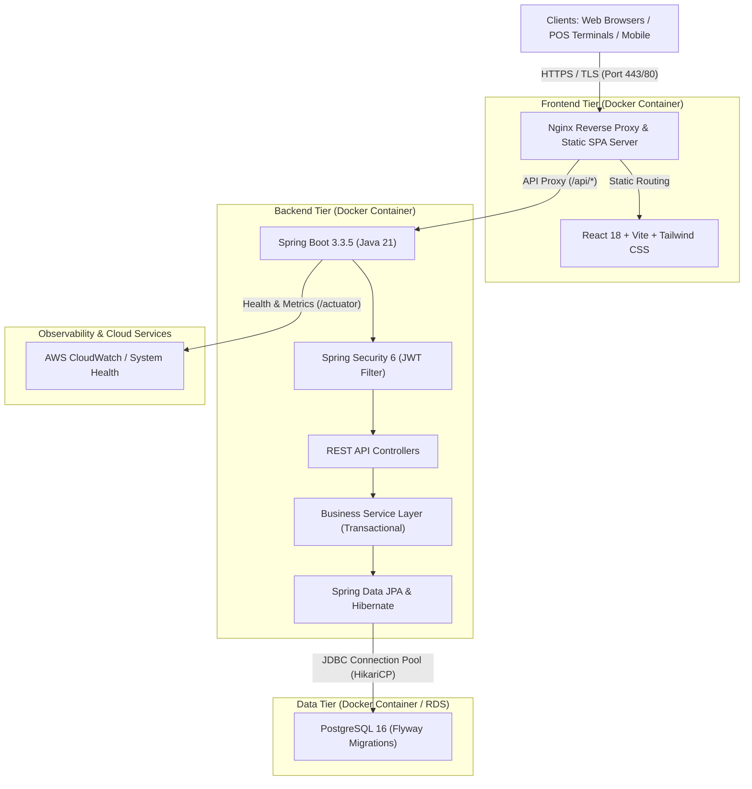
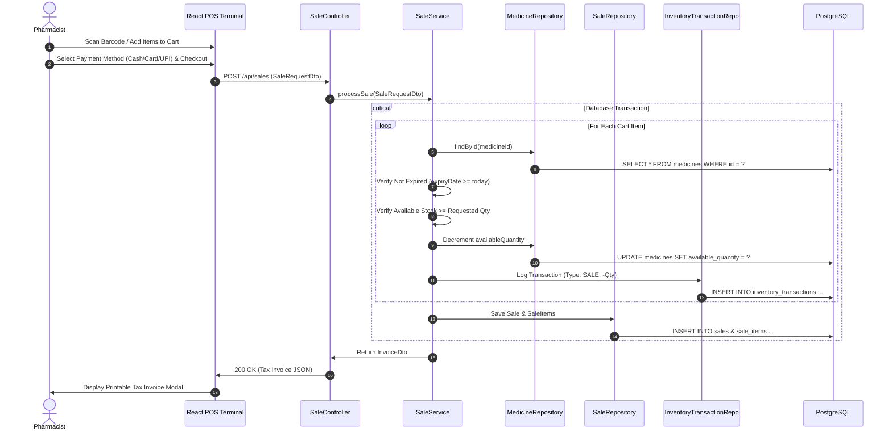
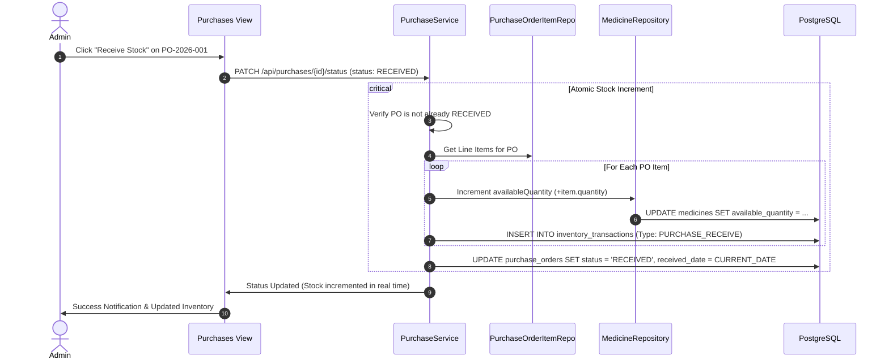
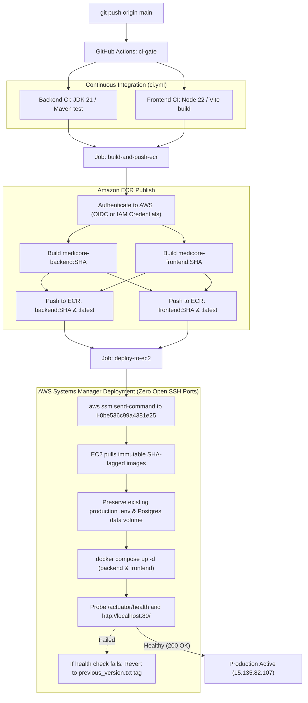

# MediCore – System Architecture & Technical Design

## 1. Executive Architecture Overview

**MediCore** is an enterprise-grade Smart Pharmacy Management SaaS platform engineered with a decoupled multi-tier architecture. It delivers real-time inventory lot tracking, Point of Sale (POS) checkout, automated supplier procurement reconciliation, and clinical expiry tracking.



---

## 2. Layered Backend Architecture

The backend strictly follows the **Controller &rarr; Service &rarr; Repository &rarr; Database** pattern:

1. **Controller Layer (`com.medicore.controller`)**:
   - Exposes RESTful endpoints conforming to HTTP conventions (`GET`, `POST`, `PUT`, `PATCH`, `DELETE`).
   - Validates incoming request payloads using Jakarta Bean Validation (`@Valid`, `@NotNull`, `@Min`, `@DecimalMin`).
   - Translates domain exceptions into structured JSON responses through `GlobalExceptionHandler`.
   - Documents all endpoints via OpenAPI 3 / Swagger (`@Tag`, `@Operation`).

2. **Service Layer (`com.medicore.service`)**:
   - Encapsulates core business rules (e.g., preventing negative inventory, preventing sale of expired medicines, transactional multi-table updates).
   - Manages database transaction boundaries with `@Transactional` (ensuring atomic updates for inventory adjustments and billing).
   - Maps database entities to DTOs to avoid leaking persistence internals to clients.

3. **Repository Layer (`com.medicore.repository`)**:
   - Extends Spring Data `JpaRepository` for type-safe queries and pagination.
   - Leverages JPQL queries with aggregation (`SUM`, `COUNT`, `GROUP BY`) for live KPI statistics and reporting without hardcoded values.

4. **Security Filter Chain (`com.medicore.security`)**:
   - Stateless JWT Bearer token authentication via `AuthTokenFilter`.
   - Token creation and cryptographic verification using HMAC-SHA256 (`jjwt` 0.12.6).
   - Role-Based Access Control (`ADMIN`, `PHARMACIST`).

---

## 3. Sequence Workflows

### 3.1 Point of Sale (POS) Checkout Transaction



### 3.2 Purchase Order Receipt & Inventory Reconciliation



---

## 4. Docker Network Topology

```
+-------------------------------------------------------------+
|                     Docker Host (EC2)                       |
|                                                             |
|   +-------------------+              +------------------+   |
|   |                   |   :8080      |                  |   |
|   | medicore-frontend |------------->| medicore-backend |   |
|   |  (Nginx + SPA)    |   (proxy)    | (Spring Boot 3)  |   |
|   +-------------------+              +------------------+   |
|             |                                 |             |
|             | :80 (Public)                    | :5432       |
|             v                                 v             |
|      Internet Clients               +-------------------+   |
|                                     | medicore-postgres |   |
|                                     |  (PostgreSQL 16)  |   |
|                                     +-------------------+   |
|                                               |             |
|                                               v             |
|                                        Persistent Volume    |
|                                       (/var/lib/postgresql) |
+-------------------------------------------------------------+
```

1. **Frontend Container**: Exposed on Port 80 (and 443 with SSL). Serves pre-compiled Vite production static bundles, applies gzip compression, and reverse proxies `/api/*` to the backend container over internal Docker DNS (`http://backend:8080`).
2. **Backend Container**: Listens on Port 8080 internally. Communicates with PostgreSQL on port 5432. Runs health checks via Spring Boot Actuator (`/actuator/health`).
3. **Database Container**: Isolated inside `medicore-prod-net` bridge network. Port 5432 is not exposed to the public Internet for maximum security. Data is persisted to host directory `/var/lib/medicore/pgdata`.

---

## 5. Automated CI/CD & Deployment Architecture



### Key Architectural Strengths
1. **Zero Open SSH Ports**: Deployment executes over AWS Systems Manager (SSM) agent's outbound secure channel. Port 22 is never exposed to dynamic GitHub runner IP addresses.
2. **Secrets Protection**: Existing production database passwords and JWT secrets on the EC2 host are preserved across updates, preventing configuration drift or accidental overwrites.
3. **Immutable Tagging**: Images are pinned to their short Git commit SHA, preventing tag collision and enabling instantaneous rollback to `previous_version.txt`.
4. **Data Durability**: PostgreSQL storage is bound to `/var/lib/medicore/pgdata` on the host, ensuring database persistence is completely independent of container lifecycles.


