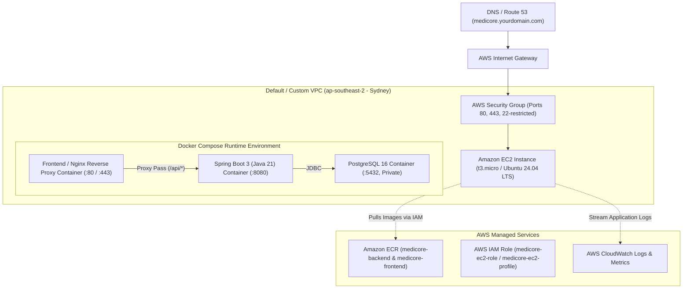
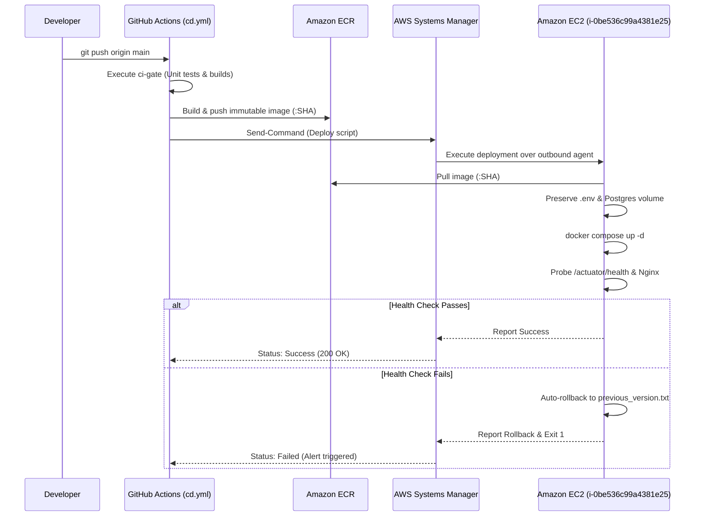

# MediCore – AWS Cloud Infrastructure & Deployment Guide

This guide details the end-to-end setup of the **MediCore Smart Pharmacy Management Platform** on Amazon Web Services (AWS), demonstrating DevOps best practices, cloud security hardening, and zero-downtime automated deployment.

---

## 1. Cloud Architecture Overview



---

## 2. Step 1: Amazon ECR Setup

Create two private Amazon ECR repositories to store versioned Docker images:

```bash
# 1. Set your AWS Region
export AWS_REGION="ap-southeast-2"

# 2. Create Backend ECR Repository
aws ecr create-repository \
    --repository-name medicore-backend \
    --image-scanning-configuration scanOnPush=true \
    --encryption-configuration encryptionType=AES256 \
    --region $AWS_REGION

# 3. Create Frontend ECR Repository
aws ecr create-repository \
    --repository-name medicore-frontend \
    --image-scanning-configuration scanOnPush=true \
    --encryption-configuration encryptionType=AES256 \
    --region $AWS_REGION
```

Note down the repository URI: `<aws_account_id>.dkr.ecr.<region>.amazonaws.com`.

---

## 3. Step 2: AWS IAM Configuration (Least Privilege)

### 3.1 EC2 Instance Role for ECR Pull
Create an IAM Role `MediCore-EC2-Role` with the following policy to allow EC2 to pull images from ECR without storing static AWS access keys on the instance:

```json
{
  "Version": "2012-10-17",
  "Statement": [
    {
      "Effect": "Allow",
      "Action": [
        "ecr:GetAuthorizationToken",
        "ecr:BatchCheckLayerAvailability",
        "ecr:GetDownloadUrlForLayer",
        "ecr:BatchGetImage",
        "logs:CreateLogStream",
        "logs:PutLogEvents"
      ],
      "Resource": "*"
    }
  ]
}
```

Attach this IAM role as an **Instance Profile** to your EC2 instance.

### 3.2 GitHub Actions Deployment User / OIDC
Create an IAM User `github-actions-medicore` for CI/CD with permissions to authenticate, build, and push to ECR:
- Policy: `AmazonEC2ContainerRegistryPowerUser`

---

## 4. Step 3: AWS Security Group Configuration

Create a Security Group `medicore-sg` with strict inbound firewall rules:

| Type | Protocol | Port Range | Source | Purpose |
|------|----------|------------|--------|---------|
| HTTPS | TCP | 443 | `0.0.0.0/0` | Public Secure Web Traffic |
| HTTP | TCP | 80 | `0.0.0.0/0` | HTTP traffic (redirected to HTTPS) & ACME SSL validation |
| SSH | TCP | 22 | `<your-office-or-home-ip>/32` | Restrict administrative SSH access to your specific IP |

> [!CAUTION]
> **Database Security Rule:** Port 5432 (PostgreSQL) and Port 8080 (internal Spring Boot) must **NEVER** be opened in the inbound Security Group. They communicate strictly over the internal Docker network.

---

## 5. Step 4: Amazon EC2 Server Provisioning & Hardening

1. **Launch EC2 Instance:**
   - AMI: Ubuntu 24.04 LTS or 22.04 LTS (x86_64)
   - Instance Type: `t3.medium` (2 vCPU, 4 GB RAM recommended for Java 21 + PostgreSQL)
   - Storage: 30 GB gp3 SSD
   - Security Group: Attach `medicore-sg`
   - IAM Role: Attach `MediCore-EC2-Role`

2. **Connect via SSH:**
   ```bash
   ssh -i medicore-key.pem ubuntu@<ec2-public-ip>
   ```

3. **Install Docker & Docker Compose Engine:**
   ```bash
   # Update system
   sudo apt update && sudo apt upgrade -y

   # Install prerequisites
   sudo apt install -y ca-certificates curl gnupg lsb-release

   # Add Docker official GPG key
   sudo install -m 0755 -d /etc/apt/keyrings
   curl -fsSL https://download.docker.com/linux/ubuntu/gpg | sudo gpg --dearmor -o /etc/apt/keyrings/docker.gpg
   sudo chmod a+r /etc/apt/keyrings/docker.gpg

   # Set up repository
   echo \
     "deb [arch=$(dpkg --print-architecture) signed-by=/etc/apt/keyrings/docker.gpg] https://download.docker.com/linux/ubuntu \
     $(lsb_release -cs) stable" | sudo tee /etc/apt/sources.list.d/docker.list > /dev/null

   # Install Docker packages
   sudo apt update
   sudo apt install -y docker-ce docker-ce-cli containerd.io docker-buildx-plugin docker-compose-plugin

   # Allow ubuntu user to execute docker without sudo
   sudo usermod -aG docker ubuntu
   newgrp docker

   # Install AWS CLI v2
   curl "https://awscli.amazonaws.com/awscli-exe-linux-x86_64.zip" -o "awscliv2.zip"
   sudo apt install -y unzip
   unzip awscliv2.zip
   sudo ./aws/install
   ```

4. **Verify Docker and AWS installation:**
   ```bash
   docker --version
   docker compose version
   aws --version
   ```

---

## 6. Step 5: HTTPS / SSL Setup with Let's Encrypt

If you have a domain pointing to your EC2 Public IP:

```bash
# Install Certbot
sudo apt install -y certbot

# Obtain SSL Certificate
sudo certbot certonly --standalone -d medicore.yourdomain.com

# Certificates will be stored in /etc/letsencrypt/live/medicore.yourdomain.com/
```

Mount `/etc/letsencrypt` into the frontend container as configured in `docker-compose.prod.yml`.

---

## 7. Step 6: GitHub Actions CI/CD Pipeline & AWS Authentication

MediCore utilizes a dual-path continuous deployment pipeline (`.github/workflows/cd.yml`) that supports both modern **AWS OIDC Federation (Zero Static Keys)** and **Scoped IAM Service Credentials**, deploying to EC2 via **AWS Systems Manager (Zero Open SSH Ports)**.

### 7.1 Method A: AWS OpenID Connect (OIDC) Federation (Recommended)

GitHub Actions authenticates to AWS without storing long-lived access keys by exchanging a cryptographically signed OIDC web identity token.

#### Workflow Permissions Configured in `cd.yml`:
```yaml
permissions:
  contents: read
  id-token: write # Generates OIDC web identity token for AWS STS
```

#### Required IAM OIDC Provider:
- **Provider URL**: `https://token.actions.githubusercontent.com`
- **Audience**: `sts.amazonaws.com`

#### IAM Role Trust Policy (`medicore-github-actions-role`):
Restricted strictly to this exact GitHub repository and the `main` branch:
```json
{
  "Version": "2012-10-17",
  "Statement": [
    {
      "Effect": "Allow",
      "Principal": {
        "Federated": "arn:aws:iam::774697186763:oidc-provider/token.actions.githubusercontent.com"
      },
      "Action": "sts:AssumeRoleWithWebIdentity",
      "Condition": {
        "StringEquals": {
          "token.actions.githubusercontent.com:aud": "sts.amazonaws.com"
        },
        "StringLike": {
          "token.actions.githubusercontent.com:sub": "repo:sunilganganagunta/pharmacy-management-platform:ref:refs/heads/main"
        }
      }
    }
  ]
}
```

> [!NOTE]
> **AWS Organizations SCP Status & Activation:**  
> On accounts enrolled in the New AWS Experience, the managed Service Control Policy (`p-sqnofg6g`) explicitly restricts `iam:CreateOpenIDConnectProvider`. To enable OIDC:
> 1. Log into [AWS Settings](https://settings.aws.com/).
> 2. Navigate to **Account & IAM Settings**.
> 3. Click **Activate Advanced IAM Capabilities** (or upgrade to standard IAM management).
> 4. In the AWS IAM Console, go to **Identity Providers** &rarr; **Add Provider** &rarr; **OpenID Connect** (`https://token.actions.githubusercontent.com`, Audience: `sts.amazonaws.com`).
> 5. Create the role with the trust policy above and attach `medicore-cicd-policy`.
> 6. Add secret `AWS_ROLE_TO_ASSUME` in GitHub Repository Settings.

---

### 7.2 Method B: Scoped IAM Service Credentials (Immediate Alternative)

If OIDC provider creation is restricted by your project's SCP, create a dedicated programmatic IAM service user (`medicore-github-actions`) with least-privilege permissions:

#### Least-Privilege IAM Policy (`medicore-cicd-policy`):
```json
{
  "Version": "2012-10-17",
  "Statement": [
    {
      "Sid": "ECRAuth",
      "Effect": "Allow",
      "Action": "ecr:GetAuthorizationToken",
      "Resource": "*"
    },
    {
      "Sid": "ECRImagePush",
      "Effect": "Allow",
      "Action": [
        "ecr:BatchCheckLayerAvailability",
        "ecr:GetDownloadUrlForLayer",
        "ecr:BatchGetImage",
        "ecr:PutImage",
        "ecr:InitiateLayerUpload",
        "ecr:UploadLayerPart",
        "ecr:CompleteLayerUpload"
      ],
      "Resource": [
        "arn:aws:ecr:ap-southeast-2:774697186763:repository/medicore-backend",
        "arn:aws:ecr:ap-southeast-2:774697186763:repository/medicore-frontend"
      ]
    },
    {
      "Sid": "SSMDeployment",
      "Effect": "Allow",
      "Action": "ssm:SendCommand",
      "Resource": [
        "arn:aws:ec2:ap-southeast-2:774697186763:instance/i-0be536c99a4381e25",
        "arn:aws:ssm:ap-southeast-2::document/AWS-RunShellScript"
      ]
    },
    {
      "Sid": "SSMStatusQuery",
      "Effect": "Allow",
      "Action": "ssm:GetCommandInvocation",
      "Resource": "*"
    }
  ]
}
```

---

### 7.3 GitHub Repository Secrets Configuration

Navigate to GitHub: **Settings &rarr; Secrets and variables &rarr; Actions** and add the following repository secrets:

| Secret Name | Value | Purpose |
| :--- | :--- | :--- |
| `AWS_ROLE_TO_ASSUME` | `arn:aws:iam::774697186763:role/medicore-github-actions-role` | *(Optional)* For OIDC passwordless federation |
| `AWS_ACCESS_KEY_ID` | `AKIA...` (from IAM user) | AWS Access Key (if not using OIDC) |
| `AWS_SECRET_ACCESS_KEY` | `wJalr...` (from IAM user) | AWS Secret Key (if not using OIDC) |
| `AWS_REGION` | `ap-southeast-2` | Primary AWS Deployment Region |
| `ECR_REGISTRY` | `774697186763.dkr.ecr.ap-southeast-2.amazonaws.com` | ECR Registry URI |
| `EC2_INSTANCE_ID` | `i-0be536c99a4381e25` | Production EC2 Instance ID |
| `POSTGRES_PASSWORD` | `<your-production-db-password>` | Production Database Password |
| `JWT_SECRET` | `<your-production-jwt-secret>` | Production JWT Signing Key |

*(Note: `EC2_SSH_KEY` is completely optional. The workflow defaults to AWS Systems Manager deployment, meaning SSH port 22 remains restricted to your IP).*

---

### 7.4 Zero-Open-Port AWS SSM Deployment Flow



## 8. Step 7: Application Monitoring & AWS CloudWatch

1. **Install CloudWatch Agent:**
   ```bash
   wget https://s3.amazonaws.com/amazoncloudwatch-agent/ubuntu/amd64/latest/amazon-cloudwatch-agent.deb
   sudo dpkg -i -E ./amazon-cloudwatch-agent.deb
   ```

2. **Configure CloudWatch to stream Docker container logs:**
   Create `/opt/aws/amazon-cloudwatch-agent/bin/config.json`:
   ```json
   {
     "logs": {
       "logs_collected": {
         "files": {
           "collect_list": [
             {
               "file_path": "/var/lib/docker/containers/*/*-json.log",
               "log_group_name": "MediCore-Docker-Containers",
               "log_stream_name": "{instance_id}"
             }
           ]
         }
       }
     }
   }
   ```

3. **Start Agent:**
   ```bash
   sudo /opt/aws/amazon-cloudwatch-agent/bin/amazon-cloudwatch-agent-ctl \
       -a fetch-config -m ec2 -s -c file:/opt/aws/amazon-cloudwatch-agent/bin/config.json
   ```

---

## 9. Verification & Rollback Testing

### Health Check Verification
```bash
# 1. Verify running containers
docker ps

# 2. Check Spring Boot Actuator
curl -f http://localhost:8080/actuator/health

# 3. Check Nginx Frontend
curl -f http://localhost:80/
```

### Manual Rollback Execution
If any issue occurs after a deployment:
```bash
cd ~/medicore-app
bash ./scripts/rollback.sh
```
This script automatically restores the previously verified Docker image tag from `previous_version.txt` and restarts the services.

