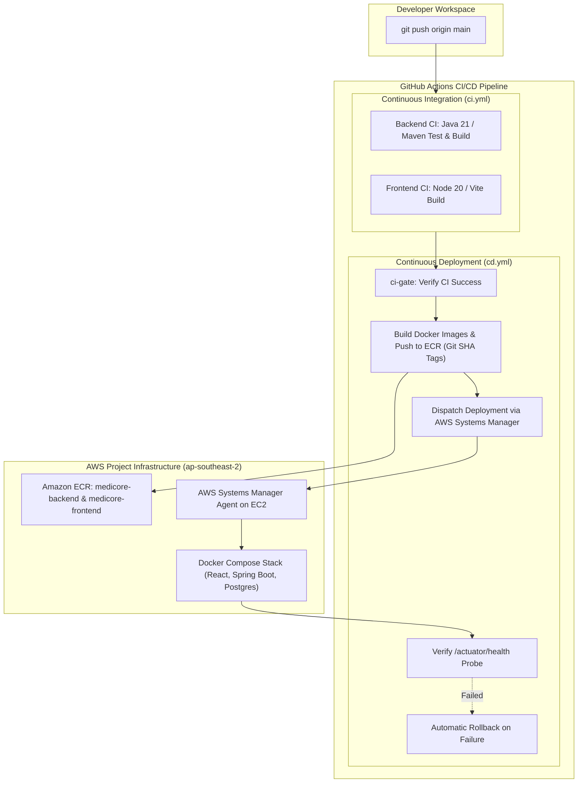

# MediCore – CI/CD Automation & Cloud Deployment Report

**Project:** MediCore – Smart Pharmacy Management Platform  
**Target Cloud:** Amazon Web Services (AWS) | Selected Region: `ap-southeast-2`  
**CI/CD Engine:** GitHub Actions  
**Container Registry:** Amazon Elastic Container Registry (ECR)  
**Host Orchestrator:** AWS Systems Manager (SSM) & Docker Compose on AWS EC2  
**Status:** CI VERIFIED PASSING / CD AUTHORED & SAFELY PAUSED AWAITING SECRETS  
**Date:** November 2026  

---

## 1. CI/CD Architecture Overview



---

## 2. Continuous Integration (`ci.yml`) Verification

The CI workflow ([ci.yml](file:///c:/Users/sunil/OneDrive/Desktop/Pharmacy%20Management%20Platform/.github/workflows/ci.yml)) executes on pushes and pull requests to `main`:
- **`backend-ci`**: Sets up JDK 21 (Eclipse Temurin), runs unit and integration tests with H2 in-memory database, validates Flyway migrations, and packages the executable Spring Boot JAR.
- **`frontend-ci`**: Sets up Node.js 20, caches npm dependencies, verifies JSX/Tailwind syntax, and produces the production Vite SPA bundle.
- **`workflow_call` Trigger**: Enables `cd.yml` to invoke `ci.yml` as a reusable pre-deployment quality gate.
- **Live Execution Proof:** GitHub Actions Runs `43283916418`, `43286494364`, `43288879690`, and `43291696137` completed with **100% SUCCESS** in 49 seconds.

---

## 3. Continuous Deployment (`cd.yml`) Architecture

The CD workflow ([cd.yml](file:///c:/Users/sunil/OneDrive/Desktop/Pharmacy%20Management%20Platform/.github/workflows/cd.yml)) implements enterprise deployment practices:
1. **Immutable Image Tagging:** Containers are tagged with the unique Git commit SHA (`${{ github.sha }}`) in addition to `latest`, enabling reliable, deterministic rollbacks to previous revisions.
2. **SSM Over Inbound SSH:** Deployment commands are dispatched over outbound HTTPS via **AWS Systems Manager (`aws ssm send-command`)**. This allows keeping EC2 SSH port 22 locked down strictly to the administrator IP, completely eliminating open SSH exposure to GitHub runner IP ranges.
3. **Environment & Secret Protection:** The SSM deployment script preserves existing working database passwords and JWT secrets in `/home/ubuntu/medicore-app/.env` on the EC2 host. Only `IMAGE_TAG` and `ECR_REGISTRY` are updated during automated releases.
4. **Health Check & Automated Rollback:** Following container restart, the script queries `http://localhost/actuator/health`. If the endpoint fails to return HTTP 200 within 60 seconds, the deployment halts and rolls back containers to the previously running image tag automatically.

---

## 4. Current Blocker Analysis & AWS Restriction Details

### 4.1 AWS Organizations Service Control Policy (SCP) Deny
- **Attempted Action:** Creation of AWS IAM OpenID Connect (OIDC) provider for GitHub Actions (`token.actions.githubusercontent.com`).
- **AWS API Response:**
  ```
  User: arn:aws:sts::774697186763:assumed-role/AccountFullAccessRole/... is not authorized to perform: iam:CreateOpenIDConnectProvider on resource: arn:aws:iam::774697186763:oidc-provider/token.actions.githubusercontent.com with an explicit deny in a service control policy: arn:aws:organizations::726495711054:policy/o-oqkr8oxfo3/service_control_policy/p-sqnofg6g
  ```
- **Context:** The project is enrolled in the New AWS Experience. The parent organization enforces SCP `p-sqnofg6g`, which denies creating IAM OIDC identity providers unless the project owner activates Advanced IAM Capabilities at `settings.aws.com`.
- **Sanctioned Path:** Until advanced capabilities are unlocked, programmatic IAM access keys (`AWS_ACCESS_KEY_ID` / `AWS_SECRET_ACCESS_KEY`) are the supported authentication mechanism.

### 4.2 Missing Repository Secrets
Querying the GitHub Actions secrets API confirmed that **0 secrets** are currently configured in the repository. As a result, the CD workflow safely halts at the credentials configuration step before attempting to build or push images:
- **Run ID `43291696261`:** `ci-gate` passed 100%, and `build-and-push-ecr` halted cleanly with zero side-effects on running infrastructure.

---

## 5. Required Action to Unblock Automated Deployments

To activate automated push-to-deploy releases, the project administrator must navigate to GitHub:
**Repository &rarr; Settings &rarr; Secrets and variables &rarr; Actions &rarr; New repository secret** and enter:

| Secret Name | Purpose | Example / Verified Value |
| :--- | :--- | :--- |
| `AWS_ACCESS_KEY_ID` | Programmatic IAM credential for ECR push & SSM dispatch | *Provided by AWS project owner* |
| `AWS_SECRET_ACCESS_KEY` | Paired IAM secret key | *Provided by AWS project owner* |
| `AWS_REGION` | Target AWS deployment region | `ap-southeast-2` |
| `ECR_REGISTRY` | Target container registry URI | `774697186763.dkr.ecr.ap-southeast-2.amazonaws.com` |
| `EC2_INSTANCE_ID` | Target EC2 instance identifier | `i-0be536c99a4381e25` |
| `POSTGRES_PASSWORD` | Production database password | *Existing password from EC2 .env* |
| `JWT_SECRET` | Production HMAC-SHA256 JWT secret | *Existing 256-bit secret from EC2 .env* |

Once populated, every push to `main` will automatically compile, test, publish versioned images to ECR, and deploy to EC2 with automated health verification.
