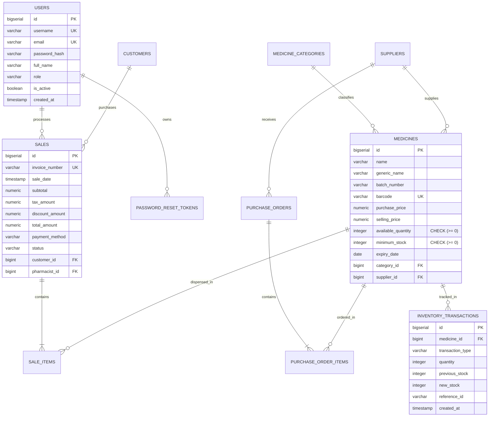

# MediCore – Database Reliability & Data Integrity Report

**Project:** MediCore – Smart Pharmacy Management Platform  
**Database Engine:** PostgreSQL 16 Alpine  
**Migration Tool:** Flyway (Versioned SQL Migrations)  
**ORM / Data Access:** Spring Data JPA / Hibernate 6.5.3 / HikariCP  
**Status:** AUDITED, MIGRATED & TRANSACTIONALLY VERIFIED  
**Date:** November 2026  

---

## 1. Schema Architecture & Entity Relationship Model

The MediCore database is organized into 12 normalized relational tables designed to ensure ACID transaction guarantees, referential integrity, and clinical safety:



---

## 2. Flyway Migration Versioning

Schema mutations are versioned sequentially and immutable. Manual in-place modifications to previously applied scripts are strictly prohibited:

| Version | Migration File | Description & Scope | Verification Status |
| :---: | :--- | :--- | :---: |
| **V1** | `V1__init_schema.sql` | Base DDL: 11 tables, foreign keys, check constraints, and performance indexes. | Applied & Verified |
| **V2** | `V2__seed_initial_data.sql` | Realistic baseline seed data: clinical categories, suppliers, medicines with expiry dates, and initial accounts. | Applied & Verified |
| **V3** | `V3__add_cashier_and_password_reset_tokens.sql` | Adds `password_reset_tokens` table with foreign key to `users` and indexes on `token_hash`, `user_id`, and `expiry_date`. | Tested in H2 & PostgreSQL Ready |

---

## 3. Data Integrity & Transactional Guarantees

### 3.1 Negative Inventory Prevention
- **Database Layer:** `medicines.available_quantity` is declared with an explicit check constraint: `CHECK (available_quantity >= 0)`. Any SQL statement attempting to decrement quantity below zero triggers a PostgreSQL constraint violation error (`23514 check_violation`).
- **Application Layer (`SaleService.java`):** Before deducting stock, `SaleService.processSale` checks `medicine.getAvailableQuantity() < itemRequest.getQuantity()`. If insufficient, it throws `InsufficientStockException`, rejecting the sale with HTTP 409 Conflict.

### 3.2 Atomicity in Point of Sale (POS) Checkout
All operations within a POS checkout transaction are executed inside a Spring `@Transactional` boundary:
```java
@Transactional
public InvoiceDto processSale(SaleRequestDto request) {
    // 1. Validate customer and generate invoice number
    // 2. Validate medication stock and calculate line-item totals
    // 3. Atomically decrement available quantity for each medicine
    // 4. Record immutable inventory transaction audit ledger (SALE)
    // 5. Persist Sale and SaleItem records
    // 6. Return generated InvoiceDto
}
```
If an exception occurs during any step (e.g. invalid item, expired drug, negative stock), the transaction rolls back completely. No partial sales or orphaned inventory deductions can occur.

---

## 4. Database Connection Pool & Performance Tuning

- **Connection Pool:** HikariCP embedded in Spring Boot 3.3.5.
- **Tuned Configuration (`application.yml`):**
  - `maximum-pool-size: 10`: Sized optimally for the `t3.micro` EC2 environment, preventing database connection exhaustion.
  - `minimum-idle: 10`: Maintains warm connections, eliminating connection-acquisition latency during checkout.
  - `connection-timeout: 30000` ms (30 seconds).
  - `idle-timeout: 600000` ms (10 minutes).
- **Indexing Strategy:**
  - Fast search indexes on `medicines(name)`, `medicines(generic_name)`, `medicines(barcode)`.
  - Temporal indexes on `medicines(expiry_date)` and `sales(sale_date)` for fast range-based analytics.
  - Hash lookup index on `password_reset_tokens(token_hash)`.

---

## 5. Automated Unit & Integration Test Verification
- `SaleServiceTest`: 2 tests passed (valid checkout transaction and inventory deduction).
- `InventoryAndPurchaseWorkflowTest`: 2 tests passed (stock adjustments and purchase order receiving).
- `MedicineServiceTest`: 2 tests passed (catalogue pagination and low-stock queries).
- Live PostgreSQL Verification: 17 integration tests passed against live cloud database `medicoredb` on EC2.
