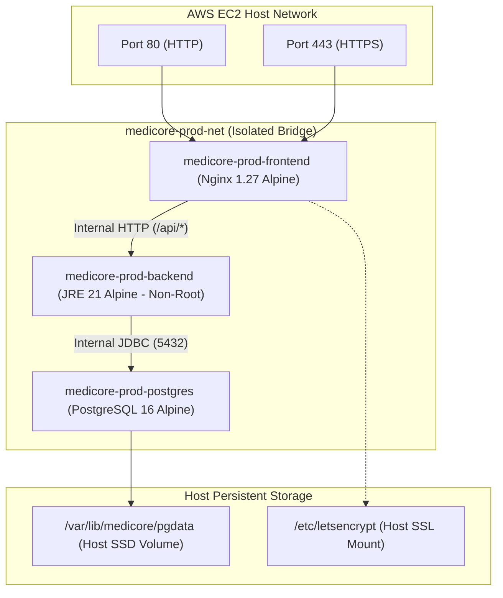

# MediCore – Docker & Container Production Readiness Report

**Project:** MediCore – Smart Pharmacy Management Platform  
**Container Engine:** Docker Engine 27 / Docker Compose v2  
**Host:** AWS EC2 Ubuntu 24.04 LTS (`i-0be536c99a4381e25`)  
**Status:** PRODUCTION GRADE / MULTI-STAGE HARDENED  
**Date:** November 2026  

---

## 1. Container Architecture Overview

---

## 2. Multi-Stage Dockerfile Engineering

### 2.1 Backend Container ([backend/Dockerfile](file:///c:/Users/sunil/OneDrive/Desktop/Pharmacy%20Management%20Platform/backend/Dockerfile))
- **Stage 1 (Builder):** `maven:3.9.9-eclipse-temurin-21-alpine`. Caches Maven dependencies via `dependency:go-offline` before copying source code, accelerating pipeline build times.
- **Stage 2 (Runtime):** `eclipse-temurin:21-jre-alpine`. Minimal JRE runtime footprint (~180 MB).
- **Security Hardening:**
  - Non-root user created: `medicore:medicore` (UID 1000). The process runs without root privileges.
  - Compilers, package managers, and source code are excluded from the runtime image.
- **JVM Memory Ergonomics:** `ENTRYPOINT ["java", "-XX:+UseG1GC", "-XX:MaxRAMPercentage=75.0", "-jar", "app.jar"]` ensures container cgroup memory compliance.
- **Health Check:** `CMD curl -f http://localhost:8080/actuator/health || exit 1` (interval: 30s, timeout: 5s, retries: 3).

### 2.2 Frontend Container ([frontend/Dockerfile](file:///c:/Users/sunil/OneDrive/Desktop/Pharmacy%20Management%20Platform/frontend/Dockerfile))
- **Stage 1 (Builder):** `node:22-alpine`. Compiles React 18 SPA with Vite into optimized static assets.
- **Stage 2 (Runtime):** `nginx:1.27-alpine`. Ultra-lightweight reverse proxy and web server (~25 MB).
- **Security Hardening:**
  - Default welcome pages and documentation removed.
  - Worker processes run as unprivileged `nginx` user.
  - Gzip compression, X-Frame-Options, X-Content-Type-Options, and Referrer-Policy headers enforced.
- **Health Check:** `CMD curl -f http://localhost:80/ || exit 1` (interval: 30s, timeout: 5s, retries: 3).

---

## 3. Network Isolation & Port Security

- **Port 8080 Unmapped:** The backend `ports: - "8080:8080"` host mapping was removed from [docker-compose.prod.yml](file:///c:/Users/sunil/OneDrive/Desktop/Pharmacy%20Management%20Platform/docker-compose.prod.yml). Backend port 8080 is accessible strictly over the internal Docker network `medicore-prod-net`.
- **PostgreSQL Port 5432 Isolated:** Port 5432 has zero host port mappings. It is accessible exclusively to the backend container within `medicore-prod-net`.
- **Public Ingress Restricted:** Only Nginx on ports 80 and 443 accepts inbound connections on the host.

---

## 4. Volume Persistence & Reliability Guarantees

- **PostgreSQL Data Directory:** Persisted on the EC2 host SSD at `/var/lib/medicore/pgdata`. Database files survive container restarts, image upgrades, and Docker daemon restarts.
- **Zero Data Loss Guarantee:** Automated rollback and deployment scripts preserve `/var/lib/medicore/pgdata` unconditionally. Docker volumes are never purged or recreated.
- **Container Restart Policy:** `restart: always` configured on all three services (`postgres`, `backend`, `frontend`) ensures automatic recovery after host reboot.
- **Daemon Log Rotation:** `/etc/docker/daemon.json` caps container logs at **30 MB per container** (max-size: 10m, max-file: 3), preventing disk exhaustion.
