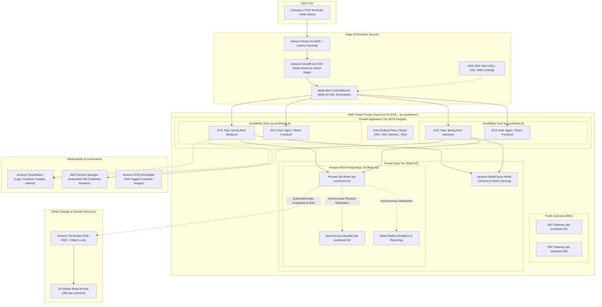
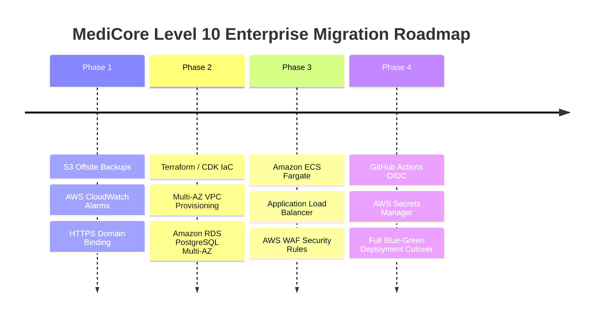

# MediCore – Enterprise Cloud Architecture Roadmap (Level 10)
### Target Multi-AZ, High-Availability & Disaster-Resilient Architecture for Scale

**Author:** DevOps & Cloud Architecture Team  
**Project:** MediCore Smart Pharmacy Management Platform  
**Target Cloud:** Amazon Web Services (AWS)  
**Selected Region:** `ap-southeast-2` (Sydney)  
**Architecture Maturity:** Level 10 (Enterprise-Scale Future Architecture)  
**Current Architecture:** Level 7–9 (Single-Instance EC2 + Docker Compose + Local SSD Persistence)  

---

## 1. Executive Summary & Scaling Strategy

The current deployment of MediCore runs successfully on a single **AWS EC2 (`t3.micro`)** instance in Sydney (`ap-southeast-2`), utilizing Docker Compose to orchestrate React 18, Spring Boot 3.3.5, and PostgreSQL 16. While this single-host topology is optimal for the initial launch, development testing, and zero-cost operation under the AWS Free Tier, enterprise healthcare workloads require:
1. **High Availability (HA)**: 99.99% uptime with zero single points of failure (SPOF).
2. **Elastic Scalability**: Automatic horizontal scale-out during morning and evening pharmacy peak checkout hours.
3. **Regulatory & Compliance Resiliency**: Point-In-Time Recovery (PITR), HIPAA/GDPR-aligned data isolation, and immutable audit trails.
4. **Zero-Downtime Deployments**: Blue/Green or Canary releases without disrupting ongoing POS checkout transactions.

This document outlines the evolutionary transition from the current Level 9 operational baseline to the target **Level 10 Enterprise Multi-AZ Architecture**.

---

## 2. Target Architecture Overview

---

## 3. Component Deep Dive

### 3.1 Network Architecture & VPC Subnet Layout

| Subnet Type | CIDR Block | Availability Zone | Function / Workload |
| :--- | :--- | :--- | :--- |
| **Public Subnet 1** | `10.0.1.0/24` | `ap-southeast-2a` | Application Load Balancer, NAT Gateway 1 |
| **Public Subnet 2** | `10.0.2.0/24` | `ap-southeast-2b` | Application Load Balancer, NAT Gateway 2 |
| **Private App Subnet 1** | `10.0.10.0/24` | `ap-southeast-2a` | ECS Fargate Backend & Frontend Tasks |
| **Private App Subnet 2** | `10.0.20.0/24` | `ap-southeast-2b` | ECS Fargate Backend & Frontend Tasks |
| **Private Data Subnet 1** | `10.0.100.0/24` | `ap-southeast-2a` | Amazon RDS PostgreSQL Primary Instance |
| **Private Data Subnet 2** | `10.0.200.0/24` | `ap-southeast-2b` | Amazon RDS PostgreSQL Standby Replica |

- **Zero Direct Ingress**: Compute tasks in private subnets have no public IP addresses. Inbound traffic only arrives via the Application Load Balancer. Outbound internet egress (for Maven/Alpine updates or third-party webhooks) routes through redundant AWS NAT Gateways.
- **Strict Security Group Chain**:
  - `ALB-SG`: Ingress `80, 443` from `0.0.0.0/0`.
  - `ECS-App-SG`: Ingress `8080, 80` *exclusively* from `ALB-SG`.
  - `RDS-SG`: Ingress `5432` *exclusively* from `ECS-App-SG`. Direct access from any other subnet or IP is blocked at the packet level.

---

### 3.2 Compute & Container Orchestration Tier (Amazon ECS Fargate)

1. **Serverless Infrastructure**:
   - Eliminates EC2 host operating system maintenance, kernel patching, swap management, and SSH key management.
   - Each microservice (Spring Boot backend and Nginx frontend) runs in isolated task definitions with dedicated CPU and RAM allocations.
2. **Auto Scaling Policies**:
   - **Scale Out**: Metric `ECSServiceAverageCPUUtilization` > 70% or `ECSServiceAverageMemoryUtilization` > 75% for 3 consecutive 1-minute periods. Adds 1 task up to a maximum of 10 tasks.
   - **Scale In**: Metric < 30% for 15 consecutive minutes. Decrements tasks gracefully down to a baseline minimum of 2 tasks (1 per AZ).
3. **Deployment Strategy**:
   - **AWS CodeDeploy Blue/Green**: Launches green replacement tasks, verifies the `/actuator/health` endpoint, shifts live traffic over 5 minutes (linear 20% every minute), and terminates old blue tasks only when zero errors occur.
   - Instant rollback if HTTP 5xx responses exceed 1% during traffic shifting.

---

### 3.3 Database Tier (Amazon RDS PostgreSQL Multi-AZ)

1. **High Availability Configuration**:
   - Engine: PostgreSQL 16.
   - Instance Class: `db.t4g.medium` (2 vCPU, 4 GiB RAM, Graviton3 processor).
   - Multi-AZ Deployment: Synchronous replication to an active standby in `ap-southeast-2b`.
   - Automatic Failover: If the primary instance fails, AWS automatically swaps DNS endpoints to the standby in under 60 seconds with zero data loss (RPO = 0).
2. **Read Replica for Analytics**:
   - Asynchronous read replica provisioned for heavy sales analytics, monthly audit reports, and CSV inventory exports (`/api/reports/**`).
   - Prevents long-running analytical queries from consuming write locks or database connections needed by real-time POS checkout transactions.
3. **Backup & Retention**:
   - Automated continuous Write-Ahead Log (WAL) archiving enables Point-In-Time Recovery (PITR) to any second within the last 35 days.
   - Daily automated EBS snapshots stored durably across multiple AZs in Amazon S3.

---

### 3.4 Storage & Offsite Disaster Recovery Tier (Amazon S3)

To replace local EC2 host backups (`/var/backups/medicore/`), the Level 10 architecture incorporates an automated offsite backup bucket:

1. **Bucket Configuration**:
   - Name: `medicore-backups-774697186763`
   - Region: `ap-southeast-2` (selected Region)
   - Encryption: Server-Side Encryption with AWS KMS (SSE-KMS) using a customer-managed key (`arn:aws:kms:ap-southeast-2:774697186763:key/medicore-backup-key`).
   - Bucket Versioning: Enabled to protect against accidental deletion or ransomware modification.
   - S3 Object Lock: WORM (Write Once, Read Many) retention for 30 days to satisfy healthcare audit compliance.
2. **S3 Lifecycle Rules**:
   - Day 0–30: S3 Standard (immediate access for rapid disaster recovery).
   - Day 31–90: Transition to S3 Glacier Flexible Retrieval (retrieval within minutes, 65% cost reduction).
   - Day 91–365: Transition to S3 Glacier Deep Archive (long-term historical retention at $0.00099 per GB/month).
   - Day 366: Permanent expiration.

---

### 3.5 Security, Secrets & Identity Federation

1. **GitHub Actions OIDC Federation**:
   - Fully transition CI/CD from static `AWS_ACCESS_KEY_ID` to AWS IAM OIDC Provider (`token.actions.githubusercontent.com`).
   - GitHub Actions assumes `arn:aws:iam::774697186763:role/medicore-github-actions-role` using short-lived (1-hour) tokens scoped to `repo:sunilganganagunta/pharmacy-management-platform:ref:refs/heads/main`.
2. **AWS Secrets Manager**:
   - Replaces hardcoded `.env` files with AWS Secrets Manager.
   - Spring Boot integrates via `spring-cloud-starter-aws-secrets-manager-config`.
   - Database credentials rotate automatically every 30 days via an AWS Lambda rotation function without application restarts.
3. **Edge Defense (AWS WAF & CloudFront)**:
   - AWS WAF WebACL attached to ALB with rate-based rules (max 500 requests per 5 minutes per IP to mitigate DDoS attacks).
   - Core Rule Set (CRS) inspection to block SQL injection and cross-site scripting (XSS) payloads.

---

## 4. Cost Analysis & Financial Trade-Off Comparison

| Infrastructure Component | Current Level 9 (Single EC2 Host) | Proposed Level 10 (Enterprise Multi-AZ) | Notes / Pricing Basis |
| :--- | :--- | :--- | :--- |
| **Compute** | $0.00 / mo (Free Tier `t3.micro`) | $28.50 / mo (ECS Fargate, 2 tasks 0.5 vCPU/1GB) | Serverless, zero OS management |
| **Load Balancing** | $0.00 / mo (Nginx on EC2 host) | $22.26 / mo (AWS Application Load Balancer) | Managed SSL, Multi-AZ failover, WAF |
| **Relational Database** | $0.00 / mo (PostgreSQL on Docker) | $58.40 / mo (Amazon RDS Multi-AZ `db.t4g.small`) | Synchronous HA, automated snapshots |
| **NAT Gateways** | $0.00 / mo (Direct public subnet) | $65.70 / mo (2 AZs x $32.85/mo) | Private subnet outbound connectivity |
| **Offsite Backup Storage** | $0.00 / mo (Local EC2 disk) | $0.25 / mo (Amazon S3 + Glacier storage) | 100 GB backups with KMS encryption |
| **Secrets & Encryption** | $0.00 / mo (Host `.env` chmod 600) | $0.80 / mo (AWS Secrets Manager + KMS key) | Automated secret rotation |
| **Domain & DNS** | $0.00 / mo (Raw Elastic IP) | $0.50 / mo (Route 53 Hosted Zone) | Custom domain + health routing |
| **Estimated Total Monthly Cost** | **$0.00 – $7.50 / month** | **~$176.41 / month** | Enterprise 99.99% SLA architecture |

### Cost-Benefit Analysis
- **When to stay on Level 9**: Prototype, staging, academic review, single-pharmacy pilot (< 5,000 transactions/day). Current single EC2 host with 2 GB swap and automated nightly encrypted backups delivers exceptional performance at $0.00 cost.
- **When to migrate to Level 10**: Commercial hospital contracts, multi-branch pharmacy chains (> 50,000 transactions/day), or strict compliance requirements where 1 hour of downtime costs more than $500 in lost revenue.

---

## 5. Phased Implementation Roadmap

1. **Phase 1 (Immediate Next Steps - Low Cost / Zero Risk)**:
   - Attach external S3 bucket (`medicore-backups-774697186763`) to existing `/opt/medicore/scripts/backup.sh` using `aws s3 cp`.
   - Provision 2 zero-cost CloudWatch alarms (CPU > 85%, StatusCheckFailed > 0).
   - Point custom domain A-record to `15.135.82.107` and execute Certbot HTTPS setup.
2. **Phase 2 (Database Decoupling - Month 2)**:
   - Provision Amazon RDS PostgreSQL Multi-AZ in private subnets using Terraform or AWS CDK.
   - Run `pg_dump` on EC2, restore into RDS, update Spring Boot `SPRING_DATASOURCE_URL`, and verify zero data drift.
3. **Phase 3 (Container Migration to ECS Fargate - Month 3)**:
   - Deploy Application Load Balancer with ACM SSL certificate.
   - Migrate Docker Compose service definitions to Amazon ECS task definitions.
   - Enable target-tracking auto scaling and health check routing.
4. **Phase 4 (Enterprise Identity & Edge Hardening - Month 4)**:
   - Activate AWS IAM OIDC for GitHub Actions.
   - Migrate application credentials to AWS Secrets Manager.
   - Attach AWS WAF to ALB and execute production cutover.
