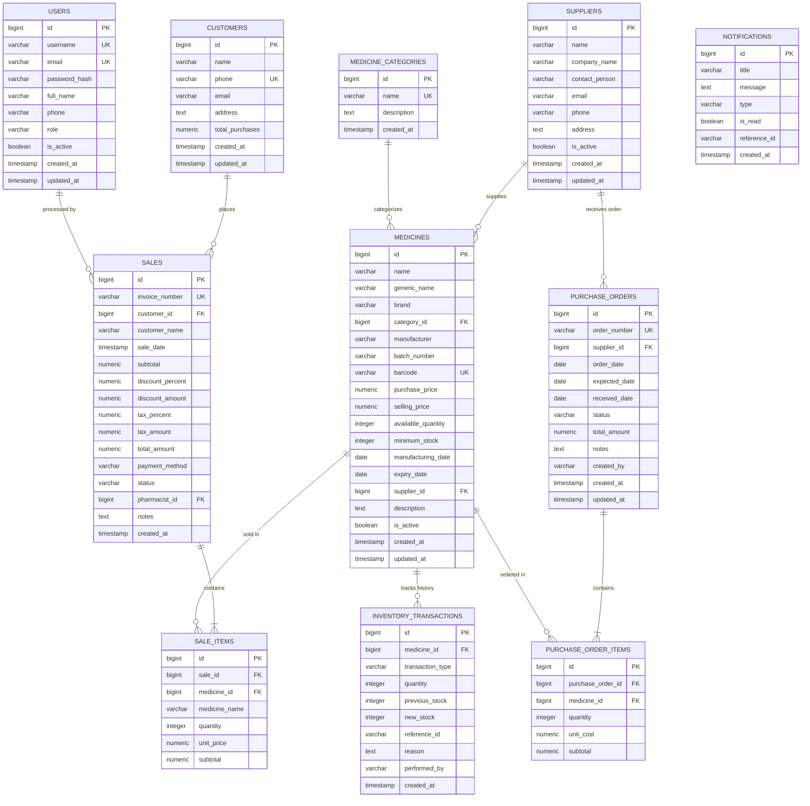

# MediCore – Relational Database Design & ER Diagram

## 1. Database Entity-Relationship Diagram

---

## 2. Table Specifications & Indexes

| Table Name | Primary Key | Foreign Keys | Key Indexes | Purpose |
|------------|-------------|--------------|-------------|---------|
| `users` | `id` | None | `username` (UK), `email` (UK) | Pharmacist & Admin authentication |
| `medicine_categories` | `id` | None | `name` (UK) | Drug classifications |
| `suppliers` | `id` | None | `phone` | Pharmaceutical vendor directory |
| `medicines` | `id` | `category_id`, `supplier_id` | `name`, `generic_name`, `expiry_date`, `available_quantity`, `barcode` (UK) | Core medicine inventory catalog |
| `customers` | `id` | None | `phone` (UK) | Patient & customer profiles |
| `inventory_transactions` | `id` | `medicine_id` | `medicine_id`, `created_at` | Audit ledger for all stock adjustments & sales |
| `purchase_orders` | `id` | `supplier_id` | `order_number` (UK), `status`, `supplier_id` | Vendor procurement orders |
| `purchase_order_items` | `id` | `purchase_order_id`, `medicine_id` | `purchase_order_id` | PO line items |
| `sales` | `id` | `customer_id`, `pharmacist_id` | `invoice_number` (UK), `sale_date` | Retail POS invoices |
| `sale_items` | `id` | `sale_id`, `medicine_id` | `sale_id`, `medicine_id` | Itemized invoice records |
| `notifications` | `id` | None | `is_read`, `created_at` | System & inventory alerts |

---

## 3. Database Integrity & Constraints

1. **Non-Negative Quantity**: `available_quantity >= 0` check constraint guarantees that concurrent POS checkouts cannot reduce inventory below zero.
2. **Flyway Migrations**:
   - `V1__init_schema.sql`: Strictly typed schema definition with proper relational constraints.
   - `V2__seed_initial_data.sql`: Dynamic seed data utilizing `CURRENT_DATE` so live alert badges, low stock warnings, and expiring lot trackers are always active during live evaluation.
3. **Transaction Isolation**: Service methods handling sales and PO receiving are decorated with `@Transactional`, guaranteeing ACID compliance across stock decrements and invoice creation.
