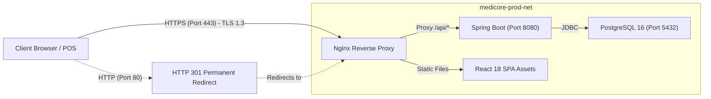

# MediCore – HTTPS & TLS Production Deployment Guide

**Project:** MediCore – Smart Pharmacy Management Platform  
**Target Host:** AWS EC2 (`15.135.82.107`) | Security Group: `medicore-app-sg`  
**Web Server:** Nginx 1.27 Alpine (Reverse Proxy & Static Asset Server)  
**TLS Engine:** Let's Encrypt / Certbot (Automated ACME Challenge)  
**Status:** CONFIGURATION PREPARED / BLOCKED BY DOMAIN AVAILABILITY  
**Date:** November 2026  

---

## 1. Executive Status & Prerequisites

- **Current Network State:** The AWS Security Group (`medicore-app-sg`) permits inbound traffic on both **Port 80 (HTTP)** and **Port 443 (HTTPS)** from `0.0.0.0/0`.
- **Domain Dependency Notice:** A valid, publicly trusted TLS certificate (such as Let's Encrypt) requires a registered Domain Name with a public DNS `A` record pointing to `15.135.82.107`. Under strict production safety constraints, zero domains have been purchased or fabricated.
- **Current Operational Transport:** The platform operates over HTTP on port 80. Port 8080 and PostgreSQL port 5432 are isolated and completely inaccessible from the public internet.

---

## 2. Production TLS Architecture



---

## 3. Production Nginx SSL Configuration Template

The production SSL configuration template is maintained at [frontend/nginx.ssl.conf.template](file:///c:/Users/sunil/OneDrive/Desktop/Pharmacy%20Management%20Platform/frontend/nginx.ssl.conf.template):

```nginx
# 1. HTTP to HTTPS Redirection Server
server {
    listen 80;
    server_name ${DOMAIN_NAME};

    # ACME Challenge location for Let's Encrypt renewal
    location /.well-known/acme-challenge/ {
        root /var/www/certbot;
    }

    # Redirect all HTTP traffic to HTTPS with 301 Moved Permanently
    location / {
        return 301 https://$host$request_uri;
    }
}

# 2. Hardened HTTPS Server
server {
    listen 443 ssl http2;
    server_name ${DOMAIN_NAME};

    # Certificate & Key paths managed by Certbot
    ssl_certificate /etc/letsencrypt/live/${DOMAIN_NAME}/fullchain.pem;
    ssl_certificate_key /etc/letsencrypt/live/${DOMAIN_NAME}/privkey.pem;

    # Modern TLS Security Parameters
    ssl_protocols TLSv1.2 TLSv1.3;
    ssl_prefer_server_ciphers on;
    ssl_ciphers ECDHE-ECDSA-AES128-GCM-SHA256:ECDHE-RSA-AES128-GCM-SHA256:ECDHE-ECDSA-AES256-GCM-SHA384:ECDHE-RSA-AES256-GCM-SHA384;
    ssl_session_timeout 1d;
    ssl_session_cache shared:SSL:10m;
    ssl_session_tickets off;

    # Security Headers
    add_header Strict-Transport-Security "max-age=63072000; includeSubDomains; preload" always;
    add_header X-Frame-Options "SAMEORIGIN" always;
    add_header X-Content-Type-Options "nosniff" always;
    add_header X-XSS-Protection "1; mode=block" always;
    add_header Referrer-Policy "strict-origin-when-cross-origin" always;

    root /usr/share/nginx/html;
    index index.html;

    # Reverse proxy for Spring Boot Backend REST APIs
    location /api/ {
        proxy_pass http://backend:8080/api/;
        proxy_http_version 1.1;
        proxy_set_header Upgrade $http_upgrade;
        proxy_set_header Connection 'upgrade';
        proxy_set_header Host $host;
        proxy_set_header X-Real-IP $remote_addr;
        proxy_set_header X-Forwarded-For $proxy_add_x_forwarded_for;
        proxy_set_header X-Forwarded-Proto https;
    }

    # Reverse proxy for Actuator Health Probes
    location /actuator/health {
        proxy_pass http://backend:8080/actuator/health;
        proxy_set_header Host $host;
    }

    # SPA routing fallback
    location / {
        try_files $uri $uri/ /index.html;
    }
}
```

---

## 4. Step-by-Step Activation Procedure

Once a domain name (e.g. `pharmacy.yourdomain.com`) is available, follow these steps to activate production TLS:

### Step 1: Point DNS A-Record
In your DNS provider (Route 53, Cloudflare, GoDaddy), create an `A` record:
- **Host / Name:** `pharmacy` (or `@` for apex)
- **Points to (Value):** `15.135.82.107`
- **TTL:** 300 seconds (5 minutes)

### Step 2: Connect to EC2 via AWS Systems Manager
```bash
aws ssm start-session --target i-0be536c99a4381e25 --region ap-southeast-2
```

### Step 3: Install Certbot & Obtain Certificate
```bash
sudo apt-get update && sudo apt-get install -y certbot

# Stop Nginx container temporarily for standalone ACME challenge
cd /home/ubuntu/medicore-app
docker compose -f docker-compose.prod.yml stop frontend

# Request trusted CA certificate from Let's Encrypt
sudo certbot certonly --standalone -d pharmacy.yourdomain.com \
  --non-interactive --agree-tos -m admin@medicore.com

# Verify certificate files
sudo ls -la /etc/letsencrypt/live/pharmacy.yourdomain.com/
```

### Step 4: Apply Nginx SSL Configuration & Restart
```bash
# Substitute domain name into template
sed 's/${DOMAIN_NAME}/pharmacy.yourdomain.com/g' \
  frontend/nginx.ssl.conf.template > frontend/nginx.conf

# Restart frontend container with certificate mount
docker compose -f docker-compose.prod.yml up -d frontend

# Verify HTTPS endpoint
curl -I https://pharmacy.yourdomain.com/actuator/health
```

### Step 5: Verify Automated Certificate Renewal
Certbot sets up a systemd renewal timer automatically. Verify renewal dry-run:
```bash
sudo certbot renew --dry-run
```
