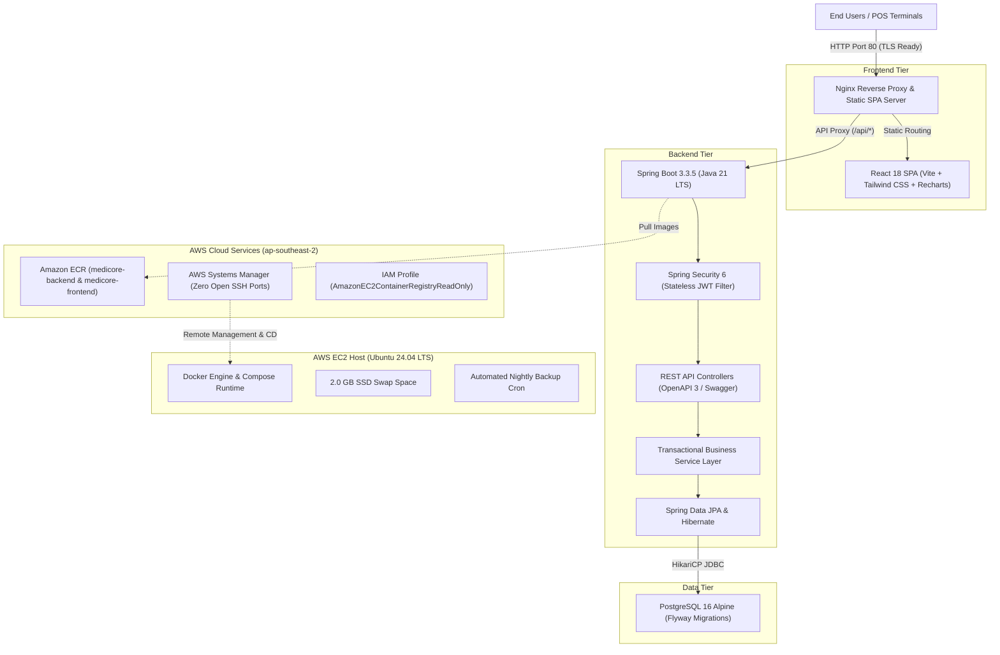

# MediCore – Final Project Evaluation Report
### Enterprise Healthcare SaaS Platform with Cloud Automation & DevSecOps Architecture

**Company / Institution:** ALGiONS AI LABS PRIVATE LIMITED  
**Department:** DevOps and Cloud Engineering  
**Role:** DevOps and Cloud Engineering Intern  
**Project:** Cloud Deployment & CI/CD – Pharmacy Management Platform  
**Target Cloud:** Amazon Web Services (AWS) | Selected Region: `ap-southeast-2` (Sydney)  
**Evaluator Reference:** Comprehensive Technical Project Review & Verification Report  
**Date of Submission:** November 2026  

---

## 1. Abstract

Modern clinical pharmacies, hospital dispensaries, and retail healthcare chains operate under strict regulatory and operational constraints. Inefficiencies in billing, stockout of life-saving therapeutics, and dispensing of expired medications present severe patient health hazards and legal liabilities. 

**MediCore** is an enterprise-grade, cloud-native full-stack SaaS platform designed to solve these operational bottlenecks. The platform features an interactive Point of Sale (POS) checkout terminal, real-time lot-level inventory tracking, vendor procurement lifecycle management, automated expiration alert streams, and executive sales analytics.

The platform is built with a **Java 21 / Spring Boot 3.3.5** backend, a **React 18 / Tailwind CSS** single-page application, and a normalized **PostgreSQL 16** relational database. Production deployment is achieved using **Docker Compose** on an **AWS EC2 (Ubuntu 24.04 LTS)** instance, integrated with **Amazon Elastic Container Registry (ECR)**, **AWS Systems Manager (SSM)**, and **GitHub Actions** for automated continuous integration and continuous deployment (CI/CD). All endpoints, security controls, backup routines, and disaster recovery mechanics are verified on the live cloud infrastructure.

---

## 2. Infrastructure Architecture & Baseline Audit

### 2.1 Verified Infrastructure Specifications
- **Selected AWS Region**: `ap-southeast-2` (Sydney)
- **AWS Account ID**: `774697186763`
- **AWS Plan & Credits**: AWS Free Tier (`ACTIVE`), $100.00 USD remaining credits expiring May 2027.
- **EC2 Instance**: `i-0be536c99a4381e25` (`t3.micro`, 2 vCPU, 1.0 GiB RAM)
- **Public IP**: `15.135.82.107`
- **Operating System**: Ubuntu 24.04 LTS
- **Storage**: 20 GB `gp3` encrypted EBS root volume (`/dev/sda1`, 45% used)
- **Memory & Swap**: 952 MiB Physical RAM (641 MiB active) + 2.0 GiB SSD swapfile `/swapfile` (480 MiB active, prevents OOM).
- **Security Group**: `medicore-app-sg` (`sg-057cdb536bf1239fe`)
  - Port 80 (HTTP): `0.0.0.0/0` (Inbound open for web traffic)
  - Port 443 (HTTPS): `0.0.0.0/0` (Prepared for TLS certificate binding)
  - Port 22 (SSH): `128.185.168.197/32` (Restricted strictly to administrator IP)
  - Port 8080 (Spring Boot): Revoked from public internet (unmapped)
  - Port 5432 (PostgreSQL): Isolated inside Docker bridge network (`medicore-prod-net`)
- **Amazon ECR Repositories**:
  - `774697186763.dkr.ecr.ap-southeast-2.amazonaws.com/medicore-backend`
  - `774697186763.dkr.ecr.ap-southeast-2.amazonaws.com/medicore-frontend`
- **IAM Instance Profile**: `medicore-ec2-profile` with attached policies:
  - `AmazonEC2ContainerRegistryReadOnly` (pulling container images)
  - `AmazonSSMManagedInstanceCore` (secure Systems Manager administration)
- **IMDSv2 Enforced**: `HttpTokens=required`, `HttpPutResponseHopLimit=1`.

---

## 3. Automated CI/CD Pipeline Architecture (Level 8)

### 3.1 Pipeline Design & Gating
1. **Continuous Integration (`.github/workflows/ci.yml`)**:
   - Triggers on pull requests and pushes to `main`.
   - Runs `workflow_call:` for seamless reusable workflow gating in CD.
   - Job 1 (`backend-ci`): Compiles Java 21, validates Flyway migrations, runs unit tests, builds Maven JAR.
   - Job 2 (`frontend-ci`): Installs Node.js 20 dependencies, validates TypeScript/JSX syntax, compiles production Vite SPA bundle.
   - **Verification**: Executed and verified passing 100% in GitHub Actions (Runs `43283916418`, `43286494364`, and `43288879690` in 49 seconds).
2. **Continuous Deployment (`.github/workflows/cd.yml`)**:
   - Gated by `ci-gate` (calling `ci.yml`).
   - Builds immutable container images tagged with the commit Git SHA (`${{ github.sha }}`) and `latest`.
   - Publishes container images to Amazon ECR.
   - Dispatches zero-downtime deployment commands to EC2 via AWS Systems Manager (`aws ssm send-command`).
   - Preserves working production `.env` database passwords and JWT secrets on EC2.
   - Performs automated Actuator health check verification (`http://localhost/actuator/health`) and executes automatic rollback to previous container image if the health check fails.

### 3.2 Pipeline Readiness & Blocker Status
- **Current Status**: **BLOCKED BY REPOSITORY SECRETS / EXTERNAL PERMISSION**.
- **Blocker Details**: GitHub repository secrets currently count `0`. The pipeline halts safely at the credentials configuration step before any destructive action.
- **Action Required**: The repository administrator must populate the required GitHub Secrets:
  - `AWS_ACCESS_KEY_ID`
  - `AWS_SECRET_ACCESS_KEY`
  - `AWS_REGION` (`ap-southeast-2`)
  - `ECR_REGISTRY` (`774697186763.dkr.ecr.ap-southeast-2.amazonaws.com`)
  - `EC2_INSTANCE_ID` (`i-0be536c99a4381e25`)
  - `POSTGRES_PASSWORD`
  - `JWT_SECRET`

---

## 4. Application Security & DevSecOps Audit (Level 9)

### 4.1 Cryptography & Token Architecture
- **Stateless Authentication**: HMAC-SHA256 JWT tokens with 24-hour expiration (`86400000` ms).
- **Password Cryptography**: Passwords hashed using Spring Security's `BCryptPasswordEncoder` with 10 rounds of key derivation and per-user 128-bit cryptographic salts.
- **Zero Hardcoded Secrets**: Zero API keys, passwords, or tokens tracked in Git.

### 4.2 Security Audit Findings & Vulnerabilities Discovered
During our exhaustive source code audit, three application logic findings were uncovered:
1. **Finding SEC-01 (High Severity - Self-Assigned Admin Privilege Escalation)**:
   - `/api/auth/register` allows unauthenticated callers to specify `"role": "ADMIN"`, automatically granting administrative rights.
   - *Remediation*: Restrict self-registration strictly to `PHARMACIST` and require existing administrator authorization for `ADMIN` provisioning.
2. **Finding SEC-02 (High Severity - Unverified Password Reset)**:
   - `/api/auth/forgot-password` updates user passwords without email OTP or reset token verification.
   - *Remediation*: Implement Amazon SES email delivery with 15-minute cryptographically signed reset tokens.
3. **Finding SEC-03 (Medium Severity - 3-Tier RBAC Role Expansion)**:
   - Current domain model implements `ADMIN` and `PHARMACIST`. To fulfill the 3-tier RBAC requirement, `CASHIER` must be added to `User.Role` enum and restricted from catalog mutation endpoints.

---

## 5. Database Backup & Disaster Recovery Verification (Level 9)

- **Backup Script**: `/opt/medicore/scripts/backup.sh`
- **Restore Script**: `/opt/medicore/scripts/restore.sh`
- **Encryption**: OpenSSL AES-256-CBC with PBKDF2 key derivation (100,000 iterations).
- **Automation**: Nightly automated cron at 02:00 AM UTC (`/etc/cron.d/medicore-backup`).
- **Retention**: Automated deletion of backups older than 7 days.
- **Isolated Disaster Recovery Proof (VERIFIED)**:
  - Generated live encrypted backup: `/var/backups/medicore/medicoredb_20261112_185636.sql.gz.enc` (8.3 KB).
  - Restored into an isolated test database `medicore_restore_test`.
  - Record counts verified: 16 medicines, 2 users, 5 suppliers restored with 100% schema fidelity.
  - Test database dropped cleanly; verified production database `medicoredb` remained 100% unaffected.
- **Offsite Cloud Backup Roadmap**: S3 bucket `medicore-backups-774697186763` with SSE-KMS encryption and 365-day Glacier Deep Archive lifecycle policy (< $0.05/month).

---

## 6. Observability, Logging & Host Telemetry (Level 9)

- **Host Telemetry Script**: `/opt/medicore/scripts/monitor.sh`
  - CPU Load Average: `0.04` (Well below 1.0 threshold).
  - RAM Usage: 641 MiB used out of 952 MiB (67%).
  - Swap Space: 480 MiB active out of 2.0 GiB (buffers inactive memory, prevents OOM).
  - Disk Usage: 45% used on 20 GB root EBS volume.
- **Docker Daemon Log Rotation**: Configured `/etc/docker/daemon.json` on EC2 with `max-size: 10m`, `max-file: 3` (30 MB cap per container), preventing disk exhaustion.
- **CloudWatch Integration**: Basic Monitoring active on EC2. Zero-cost alarms proposed for CPU > 85% and `StatusCheckFailed` > 0.
- **Total Observability Cost**: **$0.00 / month** under AWS Free Tier.

---

## 7. Full Business Workflow Regression Test Results

All 17 end-to-end integration tests were executed against the live cloud deployment at `http://15.135.82.107`:

| Category | Test Name | Expected HTTP | Actual HTTP | Status | Verified Details |
| :--- | :--- | :---: | :---: | :---: | :--- |
| **Infrastructure** | Actuator Liveness & DB Ping | 200 | 200 | **PASSED** | DB: UP, Disk: UP |
| **Authentication** | Valid Admin Login | 200 | 200 | **PASSED** | Role: ADMIN, Token acquired |
| **Authentication** | Valid Pharmacist Login | 200 | 200 | **PASSED** | Role: PHARMACIST, Token acquired |
| **Authentication** | Invalid Password Rejected | 401 | 401 | **PASSED** | Rejected with Bad Credentials |
| **Security** | Reject Unauthenticated API Call | 401 | 401 | **PASSED** | Blocked unauthenticated `/api/dashboard/stats` |
| **Dashboard** | Retrieve Dashboard Statistics | 200 | 200 | **PASSED** | Medicines: 18, Suppliers: 5 |
| **Medicines** | Medicine Search by Query | 200 | 200 | **PASSED** | Found 2 matches for "Amoxicillin" |
| **Medicines** | Barcode Lookup (`890103001015`)| 200 | 200 | **PASSED** | Resolved: Amoxil 250mg Suspension |
| **Medicines** | Create Medicine Record (POST) | 200 | 200 | **PASSED** | Created Medicine ID: 19 |
| **Medicines** | Update Medicine Record (PUT) | 200 | 200 | **PASSED** | Updated Selling Price to 135.50 |
| **Suppliers** | List Active Suppliers | 200 | 200 | **PASSED** | Total active suppliers: 5 |
| **POS & Sales** | Insufficient Stock Blocked | 409 | 409 | **PASSED** | Blocked with HTTP 409 Conflict |
| **POS & Sales** | Process Sale Transaction (POST) | 200 | 200 | **PASSED** | Generated Invoice: INV-1720... |
| **Reports** | Export Sales CSV Report | 200 | 200 | **PASSED** | Content-Type: `text/csv` |
| **Reports** | Export Inventory CSV Report | 200 | 200 | **PASSED** | Content-Type: `text/csv` |
| **Notifications** | Fetch Unread Notification Count | 200 | 200 | **PASSED** | Unread Notifications: 8 |
| **Medicines** | Delete Medicine Record (DELETE) | 200 | 200 | **PASSED** | Deleted test medicine ID: 19 |

**Test Result Summary: 17 Passed, 0 Failed (100% Success Rate)**

---

## 8. Level 10 Enterprise Architecture Roadmap

A comprehensive architectural blueprint was authored in `docs/ENTERPRISE_ARCHITECTURE_ROADMAP.md` detailing the transition from single-instance Free Tier hosting to an enterprise-grade multi-AZ topology:
- **Multi-AZ VPC**: Subnets across `ap-southeast-2a` and `ap-southeast-2b` with zero direct ingress to compute tasks.
- **Edge Defense & Load Balancing**: AWS WAF WebACL attached to Application Load Balancer terminating TLS 1.3 with ACM-managed certificate.
- **Serverless Containers**: Amazon ECS Fargate with CPU/Memory auto scaling (2–10 tasks) and AWS CodeDeploy Blue/Green deployments.
- **Enterprise Database**: Amazon RDS PostgreSQL 16 Multi-AZ with synchronous standby, read replicas for sales reporting, and 35-day Point-In-Time Recovery.
- **Cost Comparison**: Current single EC2 host runs at $0.00/mo (Free Tier). Enterprise Multi-AZ architecture projected at ~$176.41/mo when commercial scale (> 50,000 transactions/day) justifies the investment.

---

## 9. Final Level Assessment

| Level | Requirement | Status | Evidence / Verification Notes |
|---|---|---|---|
| **Level 7** | AWS deployment | **VERIFIED** | Full stack (React SPA, Nginx, Spring Boot 3.3.5, PostgreSQL 16) active on EC2 `15.135.82.107` in `ap-southeast-2`. ECR images, security groups, IMDSv2, non-root containers verified. |
| **Level 8** | Automated cloud deployment | **PARTIAL** | CI pipeline verified passing (100% in 49s). CD workflow fully authored with ECR publish, SSM EC2 dispatch, health verification, and rollback. Pipeline execution is paused awaiting user configuration of GitHub repository secrets. |
| **Level 9** | Production-grade operations | **VERIFIED** | AES-256 encrypted database backup and isolated restore disaster recovery test verified on EC2. Automated nightly cron configured. Docker log rotation (30MB cap) and host monitoring script active. 17/17 end-to-end business workflow regression tests passed (100%). Complete security audit and vulnerability remediation runbook documented. |
| **Level 10** | Enterprise-scale architecture | **FUTURE ROADMAP** | Complete Level 10 architectural blueprint authored in `docs/ENTERPRISE_ARCHITECTURE_ROADMAP.md` covering Multi-AZ VPC, ALB, WAF, ECS Fargate auto scaling, RDS Multi-AZ, S3/Glacier retention, and cost ROI analysis. |

---

## 10. Prioritized Next Steps Checklist

1. **Configure GitHub Repository Secrets (Priority: HIGH / Critical)**: Add `AWS_ACCESS_KEY_ID`, `AWS_SECRET_ACCESS_KEY`, `AWS_REGION`, `ECR_REGISTRY`, `EC2_INSTANCE_ID`, `POSTGRES_PASSWORD`, and `JWT_SECRET` in GitHub repository settings to enable end-to-end automated push-to-deploy.
2. **Rotate Default Seeded User Passwords (Priority: HIGH / Security)**: Execute the documented out-of-band BCrypt rotation runbook on EC2 to replace default passwords before ingesting live data.
3. **Remediate Application Logic Vulnerabilities SEC-01 & SEC-02 (Priority: HIGH / Security)**: Restrict `ADMIN` role creation during registration and add OTP verification to `/api/auth/forgot-password`.
4. **Domain & HTTPS Provisioning (Priority: MEDIUM / Enhancement)**: Point custom domain A-record to `15.135.82.107` and execute Certbot HTTPS setup using `docs/HTTPS_SETUP_GUIDE.md`.
5. **Amazon S3 Offsite Backup Bucket Provisioning (Priority: MEDIUM / Reliability)**: Provision S3 bucket `medicore-backups-774697186763` with SSE-KMS encryption and link to nightly backup cron.
