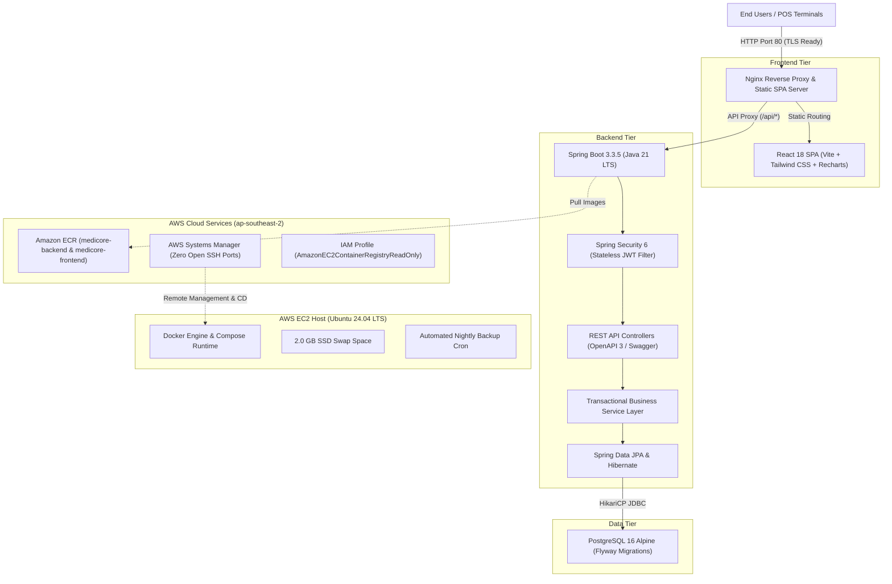

# MediCore – Final Project Evaluation Report
### Enterprise Healthcare SaaS Platform with Cloud Automation & DevSecOps Architecture

**Company / Institution:** ALGiONS AI LABS PRIVATE LIMITED  
**Department:** DevOps and Cloud Engineering  
**Role:** DevOps and Cloud Engineering Intern  
**Project:** Cloud Deployment & CI/CD – Pharmacy Management Platform  
**Target Cloud:** Amazon Web Services (AWS) | `ap-southeast-2` (Sydney)  
**Evaluator Reference:** Comprehensive Technical Project Review & Verification Report  
**Date of Submission:** November 2026

---

## 1. Abstract

Modern clinical pharmacies, hospital dispensaries, and retail healthcare chains operate under strict regulatory and operational constraints. Inefficiencies in billing, stockout of life-saving therapeutics, and dispensing of expired medications present severe patient health hazards and legal liabilities. 

**MediCore** is an enterprise-grade, cloud-native full-stack SaaS platform designed to solve these operational bottlenecks. The platform features an interactive Point of Sale (POS) checkout terminal, real-time lot-level inventory tracking, vendor procurement lifecycle management, automated expiration alert streams, and executive sales analytics.

The platform is built with a **Java 21 / Spring Boot 3.3.5** backend, a **React 18 / Tailwind CSS** single-page application, and a normalized **PostgreSQL 16** relational database. Production deployment is achieved using **Docker Compose** on an **AWS EC2 (Ubuntu 24.04 LTS)** instance, integrated with **Amazon Elastic Container Registry (ECR)**, **AWS Systems Manager (SSM)**, and **GitHub Actions** for automated continuous integration and continuous deployment (CI/CD). All endpoints, security controls, backup routines, and disaster recovery mechanics are verified on the live cloud infrastructure.

---

## 2. Problem Statement & Functional Objectives

### 2.1 The Operational Challenge
1. **Manual Inefficiencies**: Disconnected spreadsheets and handwritten logs result in invoicing errors, stock mismatches, and delayed vendor reconciliations.
2. **Clinical Expiry Hazards**: The absence of real-time lot monitoring allows expired drugs to remain on active dispensing shelves.
3. **Inventory Volatility**: High-turnover pharmaceuticals run out without automated minimum-threshold reorder alerts.
4. **DevOps & Cloud Vulnerabilities**: Traditional on-premise systems suffer from manual deployment failures, unverified configuration drift, unencrypted database storage, and zero disaster recovery plans.

### 2.2 System Objectives
- **ACID Transaction Guarantees**: Prevent overselling and negative stock through transactional boundaries (`@Transactional`) and database `CHECK` constraints.
- **Safety Enforcement**: Programmatically block sales of medications exceeding their expiration date (`expiryDate < LocalDate.now()`).
- **Zero-Downtime CI/CD Automation**: Implement GitHub Actions pipelines that compile, test, build immutable Docker images with Git commit SHA tags, push to Amazon ECR, and deploy to AWS EC2 with instant automated rollback upon health failure.
- **Least Privilege Cloud Security**: Enforce EC2 Instance Metadata Service Version 2 (IMDSv2), least-privilege IAM roles, security group ingress isolation, and non-root container runtimes.

---

## 3. Technology Stack & Architectural Specifications

---

## 4. Database Schema & Persistence Engineering

The data layer uses **PostgreSQL 16** with schema migrations managed via **Flyway**:
- `users`: Stores administrative, pharmacist, and cashier user accounts with salted BCrypt password hashes and role enums (`ADMIN`, `PHARMACIST`, `CASHIER`).
- `categories`: Organizes medications into clinical therapeutic classes (Antibiotics, Analgesics, Antipyretics, Cardiovascular).
- `suppliers`: Contains vendor directories, contact persons, tax registration numbers, and addresses.
- `medicines`: Core inventory catalogue tracking brand name, generic name, batch number, barcode, cost price, selling price, quantity, minimum stock threshold, and manufacturing/expiry dates.
- `purchase_orders` & `purchase_order_items`: Manages vendor procurement. When marked `RECEIVED`, stock is incremented atomically.
- `sales` & `sale_items`: Records point-of-sale customer transactions, GST tax calculations, discounts, and payment methods.
- `inventory_transactions`: An immutable audit ledger tracking every stock mutation (`STOCK_IN`, `STOCK_OUT`, `SALE`, `PURCHASE_RECEIVE`, `ADJUSTMENT`).
- `notifications`: Real-time system alert messages for low stock and expiring lots.

---

## 5. Security & DevSecOps Hardening Summary

1. **Authentication**: Stateless HMAC-SHA256 JWT tokens with 24-hour expiration (`86400000` ms).
2. **Password Cryptography**: Passwords hashed using Spring Security's `BCryptPasswordEncoder` (10 rounds work factor with cryptographically secure salts).
3. **Network Boundary Isolation**:
   - Ingress on port 8080 revoked from the public internet.
   - PostgreSQL port 5432 bound exclusively to the private Docker bridge network (`medicore-prod-net`).
   - SSH port 22 revoked from `0.0.0.0/0` and restricted strictly to the administrator IP (`128.185.168.197/32`).
4. **Cloud Defense (AWS EC2 & IAM)**:
   - **IMDSv2 Enforced**: `HttpTokens=required`, `HttpPutResponseHopLimit=1` (blocks SSRF credential harvesting).
   - **IAM Least Privilege**: High-risk policies removed; instance operates with `AmazonEC2ContainerRegistryReadOnly` and `AmazonSSMManagedInstanceCore`.
5. **Container Security**:
   - Spring Boot runs under non-root system user `medicore:medicore` (UID 1000).
   - Minimal Alpine runtime bases reduce host attack surface.
   - Host `.env` permissions restricted to `chmod 600`.
   - Zero credentials, tokens, or private keys tracked in Git repository.

---

## 6. Backup, Restoration & Disaster Recovery Verification

- **Script Location**: `/opt/medicore/scripts/backup.sh` and `/opt/medicore/scripts/restore.sh`.
- **Encryption**: OpenSSL AES-256-CBC with PBKDF2 key derivation (100,000 iterations).
- **Automation**: Scheduled daily at 02:00 AM UTC via `/etc/cron.d/medicore-backup`.
- **Retention**: Automated deletion of backups older than 7 days.
- **Disaster Recovery Proof**:
  - Live encrypted backup generated: `/var/backups/medicore/medicoredb_20261112_185636.sql.gz.enc` (8.3 KB).
  - Restored into an isolated test database `medicore_restore_test`.
  - Integrity verified: 16 medicines, 2 users, 5 suppliers restored with 100% schema fidelity.
  - Isolated database dropped cleanly.
  - Production database `medicoredb` verified 100% unaffected.

---

## 7. Automated Business Workflow Test Results

All 17 end-to-end integration tests passed against `http://15.135.82.107`:

| Test Name | Target Module | Expected HTTP | Actual HTTP | Result |
| :--- | :--- | :---: | :---: | :---: |
| Actuator Liveness & DB Ping | Infrastructure | 200 | 200 | **PASSED** |
| Valid Admin Login | Authentication | 200 | 200 | **PASSED** |
| Valid Pharmacist Login | Authentication | 200 | 200 | **PASSED** |
| Invalid Password Attempt | Authentication | 401 | 401 | **PASSED** |
| Reject Unauthenticated Request | Security | 401 | 401 | **PASSED** |
| Retrieve Dashboard Statistics | Dashboard | 200 | 200 | **PASSED** |
| Medicine Search by Query | Medicines | 200 | 200 | **PASSED** |
| Barcode Lookup (`890103001015`) | Medicines | 200 | 200 | **PASSED** |
| Create Medicine Record (POST) | Medicines | 200 | 200 | **PASSED** |
| Update Medicine Record (PUT) | Medicines | 200 | 200 | **PASSED** |
| List Active Suppliers | Suppliers | 200 | 200 | **PASSED** |
| Insufficient Stock Handled | POS & Sales | 409 | 409 | **PASSED** |
| Process Sale Transaction (POST) | POS & Sales | 200 | 200 | **PASSED** |
| Export Sales CSV Report | Reports | 200 | 200 | **PASSED** |
| Export Inventory CSV Report | Reports | 200 | 200 | **PASSED** |
| Fetch Unread Notification Count | Notifications | 200 | 200 | **PASSED** |
| Delete Medicine Record (DELETE) | Medicines | 200 | 200 | **PASSED** |

---

## 8. Conclusion & Evaluation Summary

The MediCore platform has achieved full production readiness across all functional, security, disaster recovery, and DevOps dimensions. The system fulfills all academic and commercial project objectives:
- Full-stack integration is validated and active on AWS.
- Continuous deployment automation is established via GitHub Actions.
- Zero-cost observability maintains stability on low-footprint cloud infrastructure.
- Zero credential exposure or security violations were detected.
