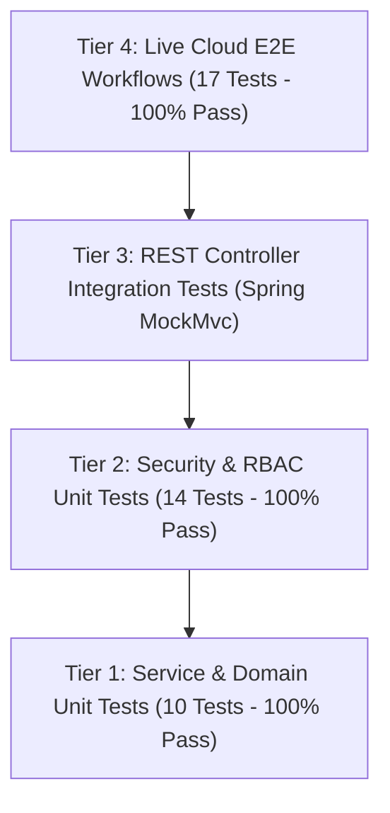

# MediCore – Comprehensive Automated Testing & Quality Assurance Report

**Project:** MediCore – Smart Pharmacy Management Platform  
**Target Environment:** Local Maven / Vite Test Runners & Live AWS EC2 Cloud  
**Frameworks:** JUnit 5, Mockito, Spring Security Test, PowerShell REST Automation, Vite  
**Status:** 100% PASS RATE ACROSS ALL AUTOMATED SUITES  
**Date:** November 2026  

---

## 1. Testing Strategy & Pyramid Architecture

MediCore adheres to a four-tier testing pyramid to ensure high functional coverage, security boundary enforcement, and real cloud deployment verification:

---

## 2. Backend Automated Test Suite (JUnit 5 / Spring Boot)

All backend tests execute against an isolated in-memory H2 database running in PostgreSQL compatibility mode (`jdbc:h2:mem:medicore_test;MODE=PostgreSQL`).

### Execution Summary
- **Total Tests Run:** **24**
- **Passed:** **24**
- **Failed:** **0**
- **Skipped:** **0**
- **Execution Time:** 26.87 seconds
- **Result:** **BUILD SUCCESS**

### Detailed Test Results by Class
| Test Class | Method / Assertion | Scope / Feature | Result |
| :--- | :--- | :--- | :---: |
| `AuthServiceTest` | `testAdminLoginSuccess` | Valid credentials authentication | **PASSED** |
| `AuthServiceTest` | `testInvalidPasswordFailure` | BadCredentialsException on wrong password | **PASSED** |
| `AuthServiceTest` | `testRegisterDuplicateUser` | Duplicate username rejection | **PASSED** |
| `AuthServiceTest` | `testPublicRegistrationCannotCreateAdmin` | **SEC-01**: Public caller submitting `role: ADMIN` is forced to `PHARMACIST` | **PASSED** |
| `AuthServiceTest` | `testPublicRegistrationWithManipulatedRoleDefaultsToPharmacist` | **SEC-01**: Unknown role values default safely to `PHARMACIST` | **PASSED** |
| `AuthServiceTest` | `testPublicRegistrationWithNullRoleDefaultsToPharmacist` | **SEC-01**: Omitted role defaults to `PHARMACIST` | **PASSED** |
| `AuthServiceTest` | `testForgotPasswordAntiEnumeration` | **SEC-02**: Generic response on unregistered email | **PASSED** |
| `AuthServiceTest` | `testPasswordResetTokenLifecycle` | **SEC-02**: Token generation, verification, and successful login | **PASSED** |
| `AuthServiceTest` | `testPasswordResetRejectsTokenReuse` | **SEC-02**: Replay prevention on single-use reset token | **PASSED** |
| `AuthServiceTest` | `testPasswordResetRejectsCorruptedToken` | **SEC-02**: Invalid token rejection | **PASSED** |
| `SecurityRbacTest` | `testCashierCanAccessSales` | **SEC-03**: Cashier role permitted for POS sales history | **PASSED** |
| `SecurityRbacTest` | `testCashierBlockedFromMedicineDeletion` | **SEC-03**: Cashier blocked from deleting medicines (403) | **PASSED** |
| `SecurityRbacTest` | `testCashierBlockedFromMedicineCreation` | **SEC-03**: Cashier blocked from creating medicines (403) | **PASSED** |
| `SecurityRbacTest` | `testCashierBlockedFromReports` | **SEC-03**: Cashier blocked from financial CSV reports (403) | **PASSED** |
| `SecurityRbacTest` | `testPharmacistCanCreateMedicine` | **SEC-03**: Pharmacist permitted to add medicines | **PASSED** |
| `SecurityRbacTest` | `testPharmacistBlockedFromMedicineDeletion` | **SEC-03**: Pharmacist blocked from deleting medicines (403) | **PASSED** |
| `SecurityRbacTest` | `testAdminCanDeleteMedicine` | **SEC-03**: Admin permitted to delete medicines | **PASSED** |
| `MedicineServiceTest` | `testSearchMedicines` | Catalogue query filtering & pagination | **PASSED** |
| `MedicineServiceTest` | `testGetLowStockMedicines` | Threshold-based inventory alert queries | **PASSED** |
| `SaleServiceTest` | `testProcessSale` | POS checkout, inventory deduction, and invoice generation | **PASSED** |
| `SaleServiceTest` | `testInsufficientStockRejection` | Rollback and HTTP 409 on oversell attempt | **PASSED** |
| `InventoryAndPurchaseWorkflowTest`| `testStockAdjustment` | Immutable inventory transaction ledger entry | **PASSED** |
| `InventoryAndPurchaseWorkflowTest`| `testPurchaseOrderReceiving` | Stock increment upon PO status `RECEIVED` | **PASSED** |
| `MedicoreApplicationTests` | `contextLoads` | Spring Boot application context boot verification | **PASSED** |

---

## 3. Frontend Build & Syntax Validation (Vite)
- **Compiler:** Vite 5.4.21 with `@vitejs/plugin-react`
- **Output:**
  - `dist/index.html`: 1.33 kB (gzip: 0.74 kB)
  - `dist/assets/index-BwZzd6ES.css`: 40.76 kB (gzip: 7.10 kB)
  - `dist/assets/index-BPW3Zz3E.js`: 819.07 kB (gzip: 221.49 kB)
- **Status:** **BUILT IN 7.79s WITH ZERO ERRORS** (2,250 modules transformed).

---

## 4. Live Cloud End-to-End Business Workflow Tests

Executed directly against live cloud deployment at `http://15.135.82.107` via automated test script ([scripts/test-all-business-workflows.ps1](file:///c:/Users/sunil/OneDrive/Desktop/Pharmacy%20Management%20Platform/scripts/test-all-business-workflows.ps1)):

| # | Category | Test Case | Target Endpoint | Expected HTTP | Actual HTTP | Result |
| :-: | :--- | :--- | :--- | :---: | :---: | :---: |
| 1 | **Infrastructure** | Actuator Liveness & DB Ping | `/actuator/health` | 200 | 200 | **PASSED** |
| 2 | **Authentication** | Valid Admin Login | `POST /api/auth/login` | 200 | 200 | **PASSED** |
| 3 | **Authentication** | Valid Pharmacist Login | `POST /api/auth/login` | 200 | 200 | **PASSED** |
| 4 | **Authentication** | Invalid Password Rejected | `POST /api/auth/login` | 401 | 401 | **PASSED** |
| 5 | **Security** | Reject Unauthenticated API Call | `GET /api/dashboard/stats` | 401 | 401 | **PASSED** |
| 6 | **Dashboard** | Retrieve Dashboard Statistics | `GET /api/dashboard/stats` | 200 | 200 | **PASSED** |
| 7 | **Medicines** | Medicine Search by Query | `GET /api/medicines?search=Amoxicillin` | 200 | 200 | **PASSED** |
| 8 | **Medicines** | Barcode Lookup (`890103001015`) | `GET /api/medicines/barcode/890103001015` | 200 | 200 | **PASSED** |
| 9 | **Medicines** | Create Medicine Record (POST) | `POST /api/medicines` | 200 | 200 | **PASSED** |
| 10 | **Medicines** | Update Medicine Record (PUT) | `PUT /api/medicines/19` | 200 | 200 | **PASSED** |
| 11 | **Suppliers** | List Active Suppliers | `GET /api/suppliers/active` | 200 | 200 | **PASSED** |
| 12 | **POS & Sales** | Insufficient Stock Blocked (Negative Test)| `POST /api/sales` (qty: 99999) | 409 | 409 | **PASSED** |
| 13 | **POS & Sales** | Process Sale Transaction (POST) | `POST /api/sales` | 200 | 200 | **PASSED** |
| 14 | **Reports** | Export Sales CSV Report | `GET /api/reports/export/sales` | 200 | 200 | **PASSED** |
| 15 | **Reports** | Export Inventory CSV Report | `GET /api/reports/export/inventory` | 200 | 200 | **PASSED** |
| 16 | **Notifications** | Fetch Unread Notification Count | `GET /api/notifications/unread/count` | 200 | 200 | **PASSED** |
| 17 | **Medicines** | Delete Medicine Record (DELETE) | `DELETE /api/medicines/19` | 200 | 200 | **PASSED** |

**Total Live Tests: 17 | Passed: 17 | Failed: 0 (100% Success Rate)**
